# Chimera


[](https://github.com/whartons/Chimera/actions/workflows/ci.yml)
[](https://github.com/astral-sh/ruff)
[](https://codecov.io/gh/whartons/Chimera)


> An **agentic generative + DCC/CAD hub** on **ComfyUI, Blender, and FreeCAD**, with a **self-correction
> loop**: every artifact is generated, judged by a VLM against a rubric, and re-generated until it passes —
> across 2D images, 3D meshes, and parametric CAD (where an LLM even writes and revises FreeCAD scripts
> until the render passes).

Run it two ways: as a **`chimera`** CLI you drive yourself (editable install from this repo —
`pip install -e .`; the workflow templates live in the checkout), or through pinned,
security-audited **MCP bridges** that let an AI assistant drive the tools for you. Image, video, audio, 3D,
Blender-render, and FreeCAD-CAD all run headless from one core — no brand and no assistant required
(`chimera image --subject "…"` just works). The judge/codegen backend is provider-agnostic (any
OpenAI-compatible LLM; the judge defaults to a local Qwen3-VL-8B served via Ollama). Public and reusable —
built end-to-end on an RTX 5090, written to help anyone on ComfyUI, especially **Blackwell (RTX 50-series)**.


<sub>Generated with the included [Qwen-Image-2.1 workflow](workflows/templates/brand-qwen-image-txt2img.json), the default image model, at 1600×960, then detailed with the built-in SeedVR2 `--upscale` pass (about 18 s together on an RTX 5090) and downscaled for this page.</sub>

**The headline — the loop correcting itself:**

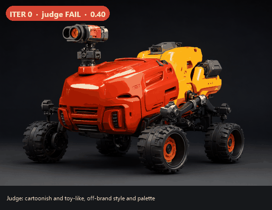

<sub>Fully local and autonomous: the Qwen3-VL-8B judge on Ollama (3-pass consensus) **fails** an off-brand render twice (0.40, 0.49). Each time, its `FIX: add…; avoid…` directives go back into the prompt and the off-brand styling comes out of the subject. The third render **passes** (1.00), with the same object and seed, and no human in the loop. It runs brandless too (a subject + quality gate). See [`modules/agent/self-correction.md`](modules/agent/self-correction.md).</sub>

**One hub, every modality** — each panel generated by the `chimera` CLI:

| image | video | 3D | Blender render | CAD |
|:---:|:---:|:---:|:---:|:---:|
|  | 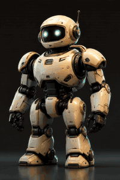 | 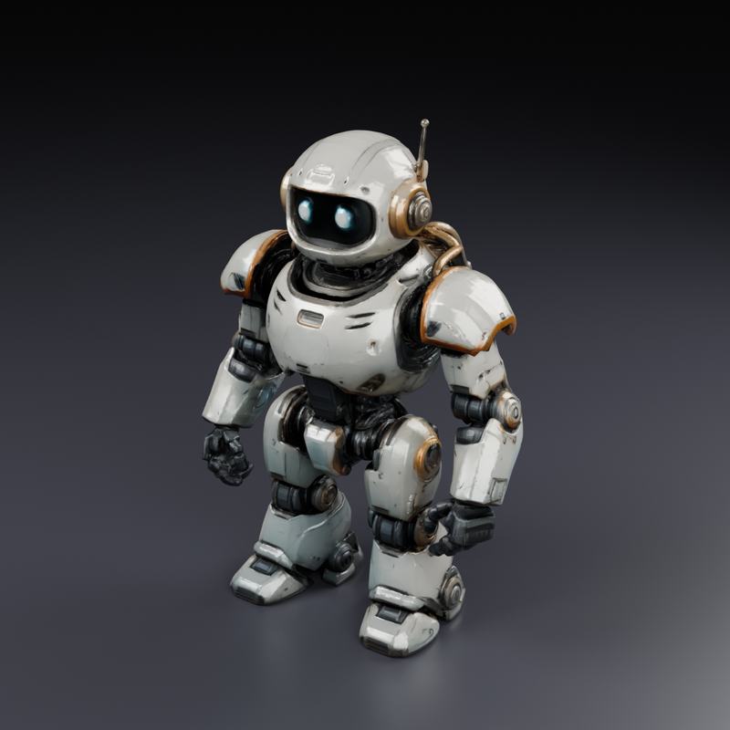 | 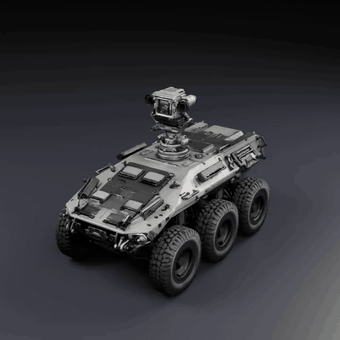 | 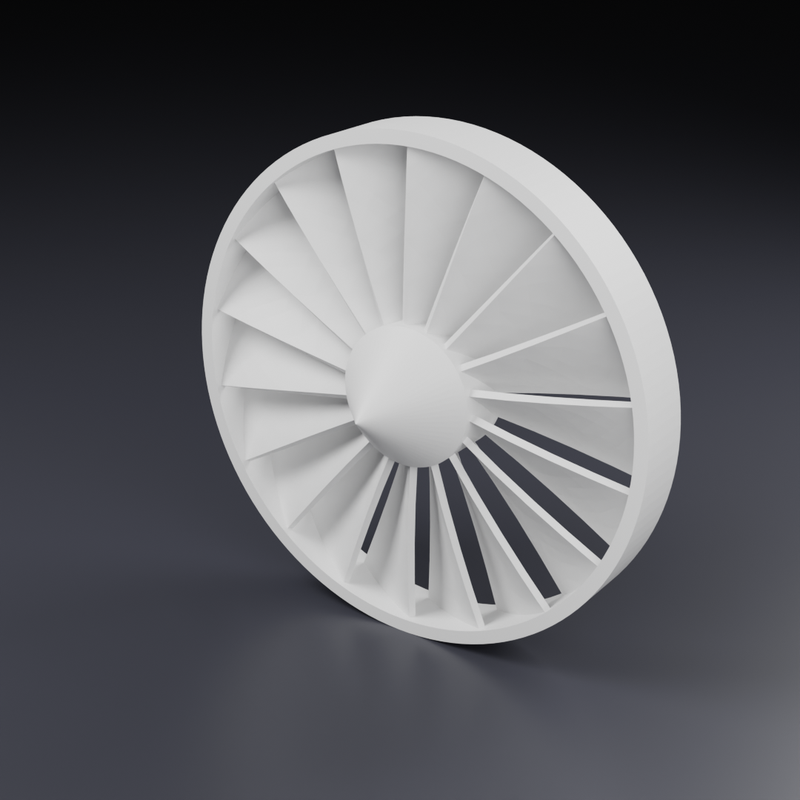 |
| `chimera image` | `chimera video` | `chimera 3d` | `chimera render` | `chimera cad` |

<sub>The image, video and 3D panels are one robot on the default models: Qwen-Image-2.1 drew it, Wan 2.2 animated it, and TRELLIS.2 turned it into a textured mesh, rendered headless in Blender. The turntable spins the example brand's textured TRELLIS.2 rover. The CAD part is a shrouded fan rotor with 18 twisted, lofted blades, built by a [FreeCAD script](modules/cad/examples/turbofan.py) run through `chimera cad --mode script`.</sub>

## ⚡ Quickstart

**Prereqs:** ComfyUI **≥ 0.40**: the default models (Qwen-Image-2.1, SeedVR2, Wan 2.2, Stable Audio 3,
TRELLIS.2) run on its core nodes. Older builds (≥ 0.24) still run the earlier models via `--model`; there,
image `--upscale` needs `--upscale-model 4x-UltraSharp.pth` (SeedVR2's nodes are new in 0.40),
`audio --mode sfx` has no older path, and the mesh3d loop needs `--mesh-model hunyuan21`. See
[`docs/SETUP.md`](docs/SETUP.md) for what to download. RTX 50-series owners should run the
[Blackwell tuning guide](docs/BLACKWELL-TUNING.md) first. Then:

```bash
git clone https://github.com/whartons/Chimera && cd Chimera
pip install -e ".[dev]"     # the `chimera` CLI + test/lint tooling (python scripts/generate.py also works)
chimera doctor              # preflight: ComfyUI reachable? node types + each modality's default models? GPU memory?
chimera free                # clear GPU memory: unload Ollama's models, then ComfyUI's
```

**Generate — no brand, no setup** (output → `outputs/<media>/`):

```bash
chimera image --subject "an armored rover"               # Qwen-Image-2.1 txt2img (--model z_image…/flux2… to switch)
chimera image --subject "a chrome emblem" --upscale      # + 4× SeedVR2 upscale
chimera video --from-image start.png --subject "rolls forward, dust"   # Wan 2.2 image→video (--camera static|pan-left|…; --model ltx23 for synced audio)
chimera audio --mode music --subject "logo sting"        # text→stinger (Stable Audio 3; --model acestep)
chimera audio --mode sfx --subject "a sword unsheathing"  # text→sound effect
chimera 3d    --from-image rover.png --format stl         # image→mesh (glb|stl|obj)
```

## 🎛️ Run it your way

**Add `--brand`** for on-brand output — style/palette injection, logo overlay, product re-render, optional
LoRA, and per-brand output routing (`brands/<brand>/outputs/…`, each with a sidecar, *moved* not copied):

```bash
chimera image --brand <brand> --mode txt2img --subject "an armored rover" --watermark   # --watermark is opt-in
chimera image --brand <brand> --mode product --asset rover.png   # the real product, placed into a new scene
chimera audio --brand <brand> --mode foley --from-video clip.mp4 --subject "tires on gravel"
```

**Headless Blender + FreeCAD** (needs Blender ≥ 5.1 / FreeCAD ≥ 1.1.4 on PATH; no ComfyUI, except
`finalize-texture --auto-repaint`, which paints its views through ComfyUI + the IPAdapter node pack):

```bash
chimera render --from rover.glb --turntable                  # Blender Cycles hero PNG + 360° MP4
chimera render --from rover.glb --mode finish --watertight   # clean → print-ready STL/GLB figurine
chimera cad --shape tube --radius 12 --inner-radius 8 --height 30 --formats step,stl   # parametric CAD solid
chimera cad --mode script --script mug.py --formats step,stl  # generative CAD: run an agent-authored FreeCAD script
chimera finalize-texture --from winner.glb --auto-repaint --concept concept.png --subject "an armored rover" --comfy-output-dir <dir>
```

**Let it correct itself** — generate → judge → refine until it passes. `--brand` is optional (brandless
judges *subject + quality*); `--pipeline mesh3d|cad` extends the loop to 3D and CAD:

```bash
python scripts/agent/auto_generate.py --subject "an armored rover" --comfy-output-dir <dir>
```

With no flags or `CHIMERA_*` variables set, the judge is Qwen3-VL-8B-Instruct on a local Ollama
(`ollama pull qwen3-vl:8b-instruct`). Pointing it at any OpenAI-compatible LLM, the optional ComfyUI Qwen3-VL
judge node (`--backend local`), and per-role codegen/judge/rewriter endpoints are in
[`modules/agent/self-correction.md`](modules/agent/self-correction.md).
**Driving Chimera from an AI agent in your IDE supersedes all endpoint config** — the agent fills those
roles itself, and no `CHIMERA_*` keys are read.

## ✅ Capabilities

| Capability | What it gives you | More |
|---|---|---|
| **Self-correction loop** | generate → VLM-judge → refine until it passes — image, 3D (`--pipeline mesh3d`), and CAD (`--pipeline cad`) | [self-correction.md](modules/agent/self-correction.md) |
| **MCP bridges** | drive ComfyUI / Blender / FreeCAD from an AI assistant, with per-tool approval gates | [modules/agent/](modules/agent/) |
| **Standalone CLI** | `chimera` over image / video / audio / 3D / render / cad — no assistant, no brand | [Quickstart](#-quickstart) |
| **Brand Kits** *(opt-in)* | `--brand` → style/palette injection, alpha-exact logo overlay, product re-render, optional LoRA | [brand-kits.md](modules/image/brand-kits.md) |
| **Reproducible** | every render writes a provenance sidecar; `chimera replay` re-runs it on the recorded model and stops if anything changed since | [below](#-reproducibility--replay) |
| **Preflight & updates** | `chimera doctor` / `update-check` / `free` (clears GPU memory); a weekly issue flags packs behind upstream | [UPDATING.md](docs/UPDATING.md) |
| **Blackwell tuning** | cu130 FP4 kernels + SageAttention + NVFP4 — **2.7× measured** on a 5090 | [BLACKWELL-TUNING.md](docs/BLACKWELL-TUNING.md) |
| **Tested, GPU-free** | **790 unit tests** (mocked ComfyUI), ruff, cross-platform CI (Linux + Windows) | [STACK.md](docs/STACK.md) |

## 🧩 Modules
| Module | What it does | Status |
|--------|--------------|--------|
| [`agent`](modules/agent/self-correction.md) | Self-correction loop (generate → VLM judge → refine) — 2D image, textured 3D mesh (`--pipeline mesh3d`), and parametric CAD (`--pipeline cad`, an LLM writes the FreeCAD script) | ✅ |
| [`agent`](modules/agent/) | MCP bridge + security model — drive ComfyUI from an assistant | ✅ |
| [`image`](modules/image/) | Qwen-Image-2.1 (default) · Z-Image · FLUX.2 — txt2img / logo / product edit / relight · `--upscale` | ✅ |
| [`video`](modules/video/) | Wan 2.2 image-to-video (default) + Fun Camera moves (`--camera`) · LTX-2.3 with native synced audio (`--model ltx23`) | ✅ |
| [`audio`](modules/audio/) | Stable Audio 3 (music + sound effects) · ACE-Step (`--model acestep`) · HunyuanVideo-Foley (video → SFX) | ✅ |
| [`threed`](modules/threed/) | TRELLIS.2 (default, textured PBR) · Pixal3D · Hunyuan3D 2.1 (shape only) — image → mesh (GLB / STL / OBJ) | ✅ |
| [`blender`](modules/blender/) | MCP bridge (live GUI); `generate.py render` (headless mesh render, ComfyUI→scene, finish/figurine); `finalize-texture` (all-around bake) | ✅ |
| [`cad`](modules/cad/) | MCP bridge (live GUI); `generate.py cad` (parametric primitives, CAD/mesh convert, agent-authored scripts) → STEP/STL/OBJ | ✅ |

## 🔭 How it works

One render is a straight pipeline; the **self-correction loop** wraps a feedback edge around it (dotted) —
the judge either accepts the candidate or folds its `FIX` directives back into the prompt and regenerates.

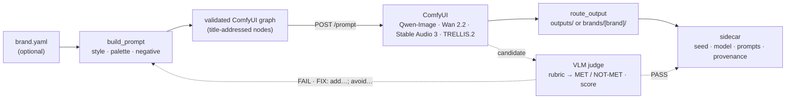

The full dependency/stack inventory (Python · ComfyUI · pinned node packs · MCP · models · CI · host) is
in [`docs/STACK.md`](docs/STACK.md).

## 🏗️ Architecture & engineering highlights

- **The agent loop is a clean abstraction.** `run_loop` depends only on a `Judge` interface, a
  `PromptExpander` interface, and an injected `generate` callable — so the whole generate→judge→refine loop
  is fully unit-testable with no ComfyUI, no GPU, no model.
- **One brand-aware core, per-modality fillers.** `manifest → prompt → validated graph → ComfyUI → routed
  output` is shared; each filler owns its model/upscaler resolution so the sidecar can't drift from the graph.
- **Nodes are addressed by stable `_meta.title`, not numeric id** — re-saving a graph in ComfyUI can't break
  the fillers.
- **Reproducibility is first-class** — schema-versioned provenance sidecars + `replay` (see below).
- **Third-party code is treated as untrusted** — the MCP server and every node pack are read, adversarially
  audited, and pinned to an exact commit before adoption, with per-tool approval gates — never `@latest`.

## 🔁 Reproducibility & replay

Every output ships a `<output>.json` sidecar recording the resolved seed, model, prompt/negative, and inputs
(input files by name, never a local path) — plus a `provenance` block (ComfyUI version, pipeline git commit,
graph structure and settings fingerprints) so an asset traces back to exactly what produced it. Re-run any
render:

```bash
chimera replay brands/<brand>/outputs/images/<name>.json                  # [--seed N] to vary
chimera replay brands/<brand>/outputs/images/<name>.json --model <file>   # run it again on another model
```

Replay pins the model the render used, so changing a brand's pinned model or a Chimera default never
silently changes an old replay. It rebuilds the render (keeping the recorded watermark decision), compares
the model, prompt, negative, structure and settings with the sidecar, and if the brand or a template changed
since, stops and lists the differences before it unloads anything from the GPU (`--accept-drift` renders
anyway; the new sidecar records what was actually used). With `--comfy-output-dir` the result lands beside
the original as `<name>_replay` (then `_replay2`, …), never over it. `--model` naming a different model
compares only the prompt, and a switch to another model family starts from that family's defaults (a Wan ↔
LTX clip takes the new family's length, fps and audio).

Sidecars get shared, so replay doesn't trust their routing: it renders on the local default ComfyUI
(`http://127.0.0.1:8000`) unless you pass `--comfy-url`, never on the recorded URL, and it refuses a
sidecar whose brand isn't a plain folder name or whose input file is an absolute or `..` path. Every render
applies the same check to the output file names ComfyUI reports before it moves anything into `outputs/`.

## 🎨 Brand Kits & the example-brand showcase

Brand Kits are an **optional layer**: point `--brand` at a folder of reference art + a YAML "brand brain" and
every render comes out on-brand, routed to a per-brand folder. The *pattern* is public; your brand **data
stays gitignored**. Scaffold and validate one:

```bash
chimera new-brand <name>      # scaffold from brands/_template/ (your brand stays gitignored)
chimera lint --brand <name>   # validate brand.yaml + referenced assets
chimera doctor --brand <name> # preflight the runtime (ComfyUI, node packs, default + brand-pinned models)
```

The tracked **[`example-brand`](brands/example-brand/)** ("Mercury Tactical Systems") was generated by the
commands above:

| `txt2img` | `product` (reference edit) | `logo` overlay |
|:---:|:---:|:---:|
| 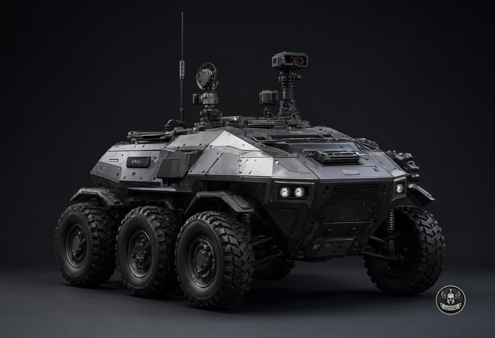 | 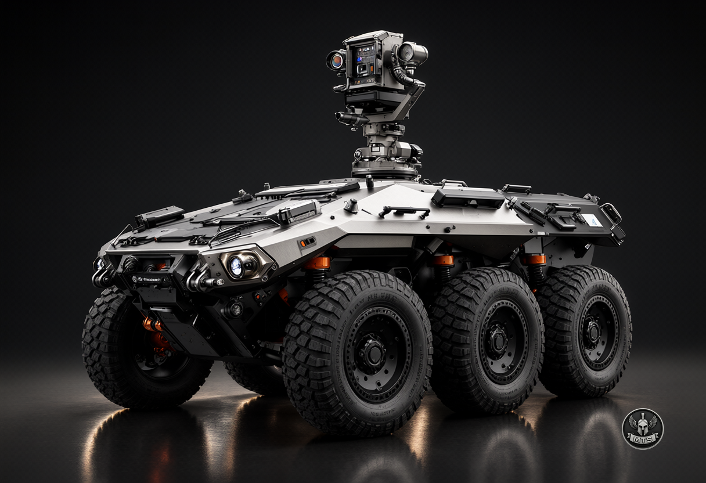 | 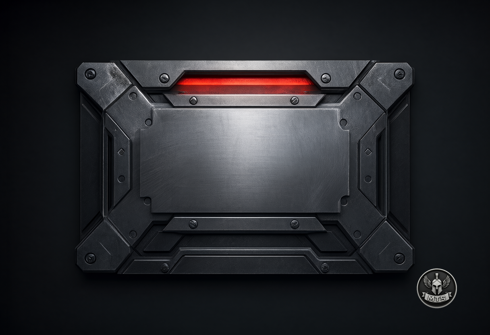 |

…plus a [video clip](brands/example-brand/outputs/video/example-brand_i2v_42.mp4) of the product rover (Wan 2.2), the
same clip [with foley sound](brands/example-brand/outputs/video/example-brand_foley_42.mp4), a
[music stinger](brands/example-brand/outputs/audio/example-brand_music_42.mp3) (Stable Audio 3), and a
[textured 3D mesh](brands/example-brand/outputs/3d/example-brand_image_42.glb) (TRELLIS.2, then slimmed from
about 75 MB to 10 MB with `chimera render --mode finish --target-tris 70000 --formats glb`, which keeps its
textures; its sidecar describes the TRELLIS.2 render). All of it was regenerated on the v0.6.0 defaults. The
**same brand brain drives a whole fleet** (in [`outputs/branded/`](brands/example-brand/outputs/branded/)):

| recon-drone | quadruped | sensor-tower | tracked-utility |
|:---:|:---:|:---:|:---:|
| 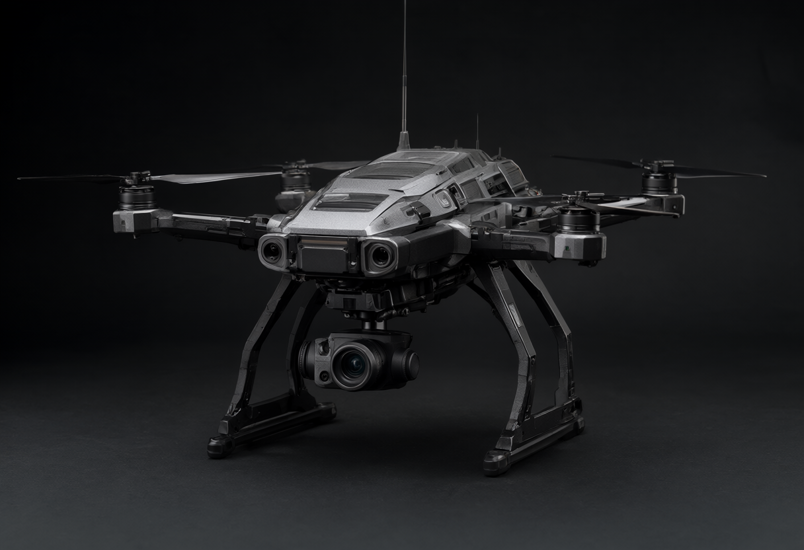 | 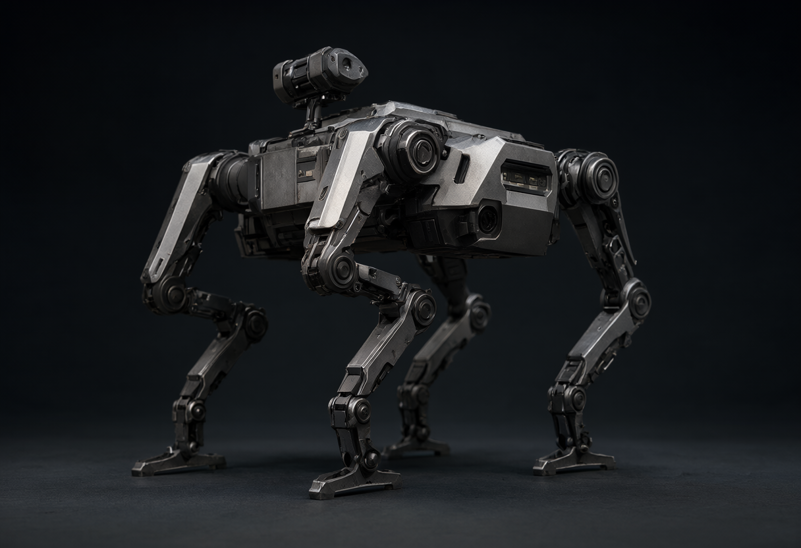 | 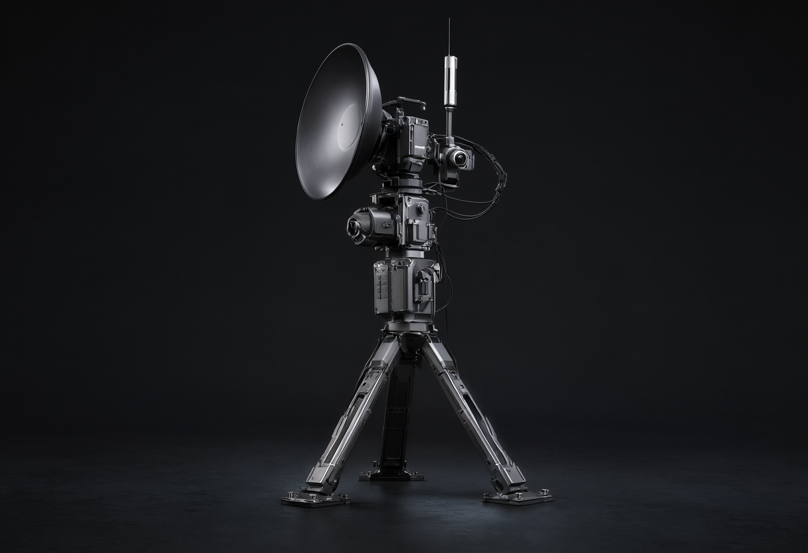 | 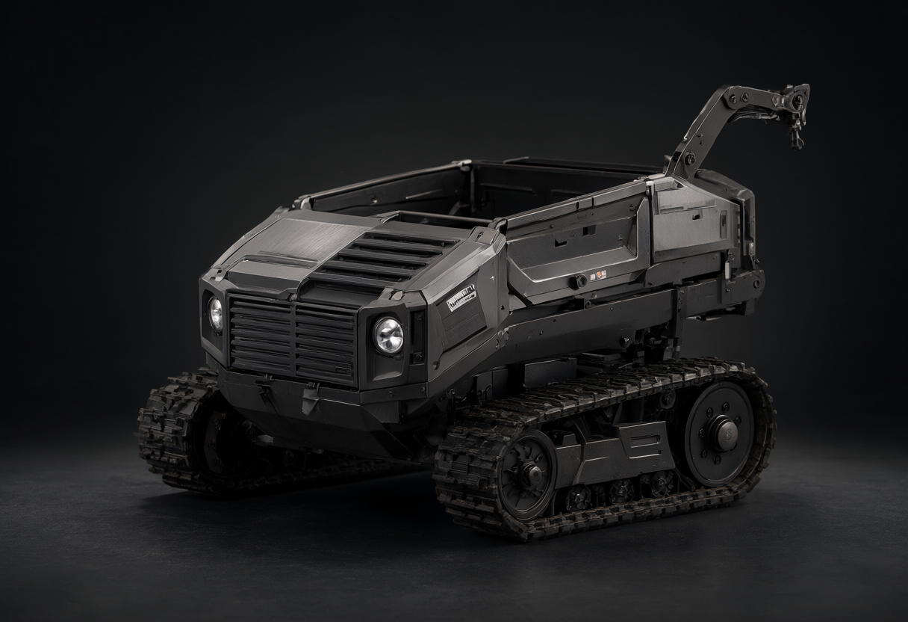 |

See [`docs/CATALOG.md`](docs/CATALOG.md) for the best free, locally-runnable models per modality (VRAM +
sources) and [`modules/image/brand-kits.md`](modules/image/brand-kits.md) for how a Brand Kit works.

## ⚡ Blackwell / RTX 50-series tuning

The part most setups get wrong. The [tuning guide](docs/BLACKWELL-TUNING.md) covers cu130 (to unlock
comfy-kitchen's FP4 kernels), SageAttention, `--fast`, and NVFP4 — with **measured numbers** (FLUX.2:
**8.4 s vs 22.7 s — a 2.7× speedup at equal quality** on a 5090) and the non-obvious
`Comfy.Server.LaunchArgs` trick for passing flags to ComfyUI **Desktop**.

## 🔒 Security & maintenance (third-party code)

The MCP server and node packs run third-party code with your privileges, so Chimera treats them as
**untrusted-by-default**:

- **Pinned + audited — never `@latest`.** Each MCP server and node pack is read through, adversarially
  audited, and pinned to an exact version/commit before adoption. The pin fixes that package's own code; its
  dependencies still resolve at install time (`comfyui-mcp@0.18.0` ships no lockfile, so its npm
  dependencies float within their caret ranges, and the `uvx` bridges don't pin their Python dependencies).
- **Loopback + inert by default.** Bridges bind to `127.0.0.1` only; optional tunnel / cloud / LLM-SDK
  features stay **env-gated and inert** unless you explicitly enable them. (`.mcp.json` sets
  `NPM_CONFIG_INCLUDE=optional` so `sharp`'s required native binary installs; the earlier
  `NPM_CONFIG_OMIT=optional` stripped it and crashed the server on node ≥ 24. Including optional packages
  also installs `cloudflared`, whose postinstall downloads the latest `cloudflared` binary from GitHub with
  no checksum.)
- **Per-tool approval gates.** Code-execution, install/download/config-changing, process-control and
  destructive MCP tools force a prompt on every call via [`.claude/settings.json`](.claude/settings.json),
  as does `generate_with_api_node` (paid partner API nodes); read-only + local generation tools stay
  frictionless.

**Takeaway:** if you adopt any community MCP server or node pack, pin it, audit it, gate the dangerous tools,
and re-scan on a cadence. Reporting a vuln? See [`SECURITY.md`](SECURITY.md). Contributing? See
[`CONTRIBUTING.md`](CONTRIBUTING.md).

## 🖥️ Hardware

Developed on an RTX 5090 (32 GB), **cu130 / torch 2.10** reference build. Most things run on far less via
quantized (GGUF / NVFP4 / fp8) weights — see each module's `models.md`.

## 🔐 Privacy model

Public repo, private work. **Tracked & shareable:** `workflows/templates/`, all `modules/`, docs, scripts.
**Gitignored:** `workflows/personal/**`, any `*.local.json`, real brands under `brands/`, `outputs/`,
`models/`, `.env`. Name any private workflow `*.local.json` and it's ignored anywhere.

## License
**Chimera's own code is MIT** — see [`LICENSE`](LICENSE); MIT applies to this repo's code only. The tools it
drives run as **separate local processes** and keep their own licenses — **ComfyUI** (GPL-3.0), **Blender**
(GPL-3.0-or-later), **FreeCAD** (LGPL-2.0+) — as do the pinned node packs and MCP bridges (see
[`docs/STACK.md`](docs/STACK.md) §3–§4). **Models** are licensed separately, some non-commercial /
personal-use; see [`docs/CATALOG.md`](docs/CATALOG.md). Nothing third-party is vendored here: Chimera
references and orchestrates these — it does not redistribute them.
