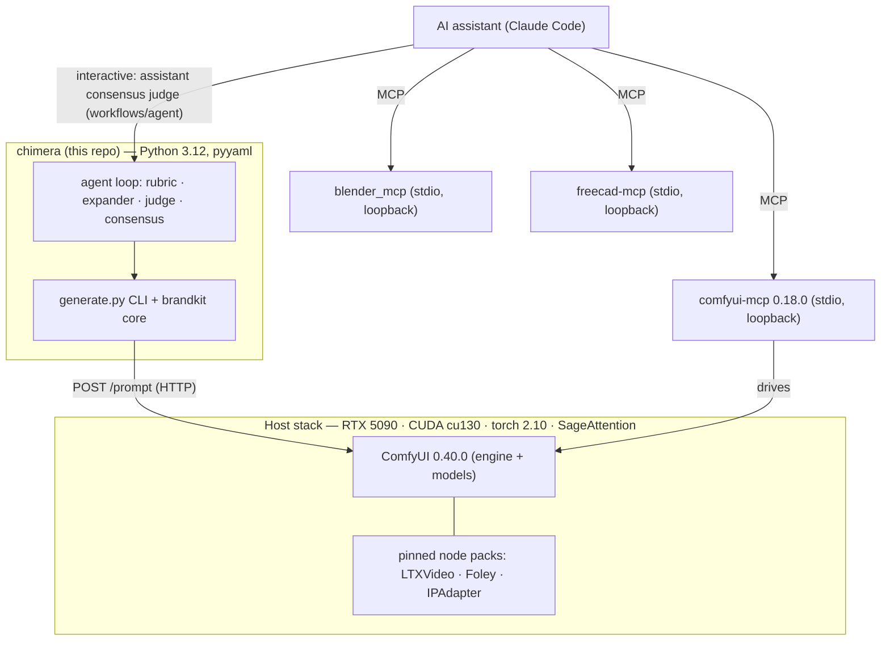

# Chimera — Stack & Dependency Inventory

One-glance inventory of everything Chimera is built and tested against: the language and Python
packages, the ComfyUI runtime, the pinned third-party node packs (with audit status), the MCP
bridge, the models, the CI actions, and the host stack. Versions/pins are the values **actually in
use** — the package keeps a deliberately tiny runtime footprint (the heavy lifting lives in ComfyUI).

> **Models** get their own, fuller catalog (files, HF repos, sizes, licenses, per modality):
> [`CATALOG.md`](CATALOG.md). **Runtime tuning** (cu130/FP4): [`BLACKWELL-TUNING.md`](BLACKWELL-TUNING.md).
> **Install**: [`SETUP.md`](SETUP.md).

---

## 1 · Language & Python packages
The `chimera` package (**v0.6.0**, MIT) is pure Python with one required runtime dependency.

| Package | Version | Scope | Used for |
|---------|---------|-------|----------|
| **Python** | `>=3.12` | runtime | everything |
| **pyyaml** | `>=6` | runtime (required) | parse `brand.yaml` manifests |
| **pytest** | `>=8` | dev | the GPU-free test suite (1196 tests) |
| **ruff** | `>=0.17.1,<0.18` | dev | lint — correctness + likely-bug + modern-syntax (`select=["F", "B", "UP"]`); one minor, the same as the pre-commit hook, so a new ruff can't break CI unannounced |
| **pytest-cov** | `>=5` | dev | coverage gate (`--cov-fail-under=85`) |
| **pillow** | `>=12.3` (12.2 has 6 PYSEC advisories) | optional `[images]` | non-PNG logo sizing (`generate._image_size`) — graceful PNG-header fallback if absent |
| **av** (PyAV) | `>=12` | optional `[video]` | foley fps/duration auto-probe (`generate._probe_video`) for clips without a Chimera sidecar (Chimera renders carry exact timing in theirs) — degrades to explicit `--fps/--duration` if absent |

`pip install -e ".[dev]"` for the full tooling; `[images]`/`[video]` are opt-in host-side helpers.

## 2 · ComfyUI runtime
| Component | Version | Notes |
|-----------|---------|-------|
| **ComfyUI** (Desktop) | **0.40.0** (reference, Comfy Desktop 1.1.7; smoke-validated 2026-10-14, then re-validated 2026-10-15 on the v0.6.0 defaults, every output checked as created by the run: Qwen-Image txt2img · product edit + SeedVR2 upscale · relight · Wan 2.2 i2v + camera move · foley · Stable Audio 3 music + sfx · TRELLIS.2 3D · render · cad · finalize-texture · image/mesh3d/cad agent loops on local Ollama models · replay) · **≥0.40** for the default models (their nodes are core in 0.40) · **≥0.24.x** runs the earlier models via `--model` · **LTX-2.3 needs the LTXVideo patch on ≥0.40** (see §3) | the generation engine (**GPL-3.0**; run as a separate process over HTTP, not vendored). ≥0.24.x is the floor because the agent verdict-capture uses the **core** node `SaveImageTextDataSetToFolder` (added in 0.24.x). CUDA 12.8+ is the floor to drive Blackwell at all. |

## 3 · Third-party ComfyUI node packs (pinned + security-audited)
Every pack is **pinned by commit** (never `@latest`) and read-through audited before adoption; a
scheduled job re-scans upstream and the pin only advances after a clean result.

| Pack | Repo | Pinned commit | Used by | Audit verdict |
|------|------|--------------|---------|---------------|
| **ComfyUI-LTXVideo** | `Lightricks/ComfyUI-LTXVideo` | `15d09ab` | video (LTX-2.3 i2v + synced audio + latent upscaler) | safe-with-precautions — never use the cloud `GemmaAPITextEncode`; avoid the prompt-enhancer's `trust_remote_code`. **On ComfyUI ≥ 0.40 apply [`modules/video/patches/ltxvideo-stg-comfyui-0.40.patch`](../modules/video/patches/ltxvideo-stg-comfyui-0.40.patch)** (the pack's STG skip returns core's new `AttentionTensorContainer`, so every STG render fails; see the video README). Re-audited `3b9c5cd → 15d09ab` (4 commits): LTX-2.5 example workflows (inert JSON) + legacy RoPE helpers made self-contained (`rope_utils.py`, pure math) + Gemma-loader dir-resolution/left-padding fixes; no new nodes, deps, or network |
| **ComfyUI-HunyuanVideo-Foley** | `phazei/ComfyUI-HunyuanVideo-Foley` | `afd2960` | audio foley (video→SFX) | safe-with-precautions — only 3 nodes used; never run the bundled `cli.py`/`infer.py`/`gradio_app.py` (pickle-RCE) |
| **ComfyUI_IPAdapter_plus** | `cubiq/ComfyUI_IPAdapter_plus` | `a0f451a` | Phase-4b auto-repaint (SDXL depth-CN + IPAdapter view generation) | safe-with-precautions — clean deps (torch/comfy/PIL/einops), no net/telemetry/exec; only the niche `IPAdapterEmbeds` loader does `torch.load` (don't feed it untrusted `.ipadpt`) |

> Core-native (no pack needed): the defaults **Qwen-Image-2.1**, **SeedVR2**, **Wan 2.2** (incl. Fun
> Camera), **Stable Audio 3** and **TRELLIS.2 / Pixal3D**, the earlier **Z-Image**, **ACE-Step 1.5** and
> **Hunyuan3D 2.1**, and the agent verdict-capture node all ship in ComfyUI core — only the three packs
> above are third-party.
>
> **Optional (agent judge):** the judge runs on a local **Ollama** model picked for the GPU by default (see §5 +
> `modules/agent/`); the `1038lab/ComfyUI-QwenVL` node can host a Qwen3-VL judge inside ComfyUI instead — re-pin to a Qwen3-VL-capable
> commit + re-scan before use. It is no longer a default/auto-checked pin.

## 4 · MCP bridges (assistant → ComfyUI · Blender · FreeCAD)
| Server | Package | Version | Transport | Security posture |
|--------|---------|---------|-----------|------------------|
| **comfyui-mcp** | npm `comfyui-mcp` (`artokun`) | **0.18.0** | stdio, **loopback only** (127.0.0.1) | MIT; audited not-malicious. Real controls: per-tool **approval gates** on the code-exec, install/download/config-changing, process-control and destructive tools (`.claude/settings.json`) + loopback-only binding + env-gating of the optional cloud/tunnel/Claude-Agent-SDK features (they stay inert unless explicitly enabled); benign `postinstall` (copies a settings template). `.mcp.json` sets **`NPM_CONFIG_INCLUDE=optional`** (replacing `NPM_CONFIG_OMIT=optional`, which on node ≥ 24 stripped `sharp`'s required native binary `@img/sharp-*` and crashed the server); the optional cloud/tunnel/agent deps install but stay inert, though installing the optional `cloudflared` package runs its postinstall, which downloads the latest `cloudflared` binary from GitHub with no checksum. The version pin fixes the server's own code: it ships no lockfile, so its npm dependencies resolve within their caret ranges at install time. Pinned + re-audited on bump; **0.20.x–0.50.x held** (issues #38/#41/#44/#49) — 0.20.9 has a broken upstream import (`@stable-canvas/comfyui-client/dist/main.modern.mjs`, absent from client `1.5.9`); 0.24.5+ adds **default-on startup self-update** (phones `registry.npmjs.org`, can `npm i @latest` on global/local installs) and **panel auto-install** (mutates the ComfyUI install from an unpinned "nightly" channel), 0.48.x layers a large multi-provider agent/network surface on top, and 0.50.x makes `npx` installs auto-update-ELIGIBLE (our exact launch mode). `.mcp.json` sets the opt-outs `COMFYUI_MCP_AUTOUPDATE=0` + `COMFYUI_MCP_PANEL_AUTOINSTALL=0` as defense-in-depth (inert on 0.18.0; they neutralize both behaviors if the pin ever drifts). See `modules/agent/README.md`. |
| **blender_mcp** | Gitea `lab/blender_mcp` (Blender Foundation) | **v1.0.0 +5** (`4309a396`) | stdio → TCP, **loopback** (127.0.0.1:9876) | GPL-3.0; first-party, **zero telemetry** (deps `docutils`/`mcp[cli]`/`pyyaml`), from-source audited. Tier-1/2 code-exec & path tools gated; launched from the pinned Gitea commit via `uvx --with "mcp[cli]~=1.12" --from "git+…#subdirectory=mcp"` (the `--with` pins the MCP SDK to 1.x — upstream imports the SDK-1.x `mcp.server.fastmcp` path and does not bound the dep) (server pkg is in the repo's `mcp/` subdir; **never** the bare `uvx blender-mcp`); never `-t http`. The commit pin fixes the server's code; its Python deps resolve when `uvx` installs it. **Gitea, not GitHub.** |
| **freecad-mcp** | GitHub `neka-nat/freecad-mcp` (server + addon) | **`78bf023`** (v0.1.27) | stdio → XML-RPC, **loopback** (127.0.0.1:9875) | MIT; no telemetry (deps `mcp[cli]>=1.28.1,<3`/`validators`, resolved when `uvx` installs it; the commit pin fixes only the server's code), from-source audited. Tier-1/2 tools gated; keep "Remote Connections" OFF. **v0.1.25+ is the security floor** ([GHSA-v4pw-r6h3-v75q](https://github.com/neka-nat/freecad-mcp/security/advisories/GHSA-v4pw-r6h3-v75q), HIGH: web pages could run Python in FreeCAD via the RPC server; fixed by refusing browser-originated requests). Pinned by commit; re-audited on bump (last: `3745ff9 → 78bf023`, 83 commits — the GHSA fix, `insert_part_from_library` path confinement, `execute_code` namespace isolation, optional auth token (`FREECAD_MCP_TOKEN`), server↔addon version handshake, threaded RPC; NEW tools `execute_code_headless` (Tier 1, gated) + `get_async_status` (read-only); no new network egress; re-copy the whole addon dir, incl. `package.xml`, into FreeCAD `Mod/`). Host: **FreeCAD 1.1.4+** (earlier releases have HIGH crafted-`.FCStd` advisories). |

> **Gitea exception:** `blender_mcp` lives on Blender's Gitea (`projects.blender.org`), not GitHub —
> Dependabot and the GitHub-compare path in `scripts/update_report.py` can't reach it, so its weekly
> check uses the Gitea compare API and bumps follow a git-SHA clone/checkout (see `UPDATING.md`).
> `freecad-mcp` **is** on GitHub, so it rides the existing `check_git_pack`.

> **Headless Blender render (shipped Phase 2):** `generate.py render` runs `blender --background
> --python <template>` as a normal CLI subprocess — separate from the MCP bridge, no per-call
> approval. Three modes (`mesh`, `comfy-scene`, `finish`) with Cycles GPU (OptiX/CUDA); templates in
> `workflows/templates/blender/`. Requires Blender ≥ 5.1 on PATH or `$BLENDER_BIN`; CI tests mock
> the subprocess (GPU-free). **Phase 4b** adds `generate.py finalize-texture` (same runner) — an
> all-around multi-view albedo bake (`_common.bake_multiview` + `mesh_finalize.py`) of a winning mesh
> from N supplied views OR **auto-generated** (`--auto-repaint`: render_views depth + SDXL depth-ControlNet
> + IPAdapter via `scripts/brandkit/repaint.py`, with silhouette masking + cross-view consistency).
>
> **Headless FreeCAD `cad` (shipped):** `generate.py cad` runs `FreeCADCmd <template>` with the params file
> passed in `$CHIMERA_CAD_PARAMS` (FreeCAD 1.1 opens a trailing file argument as a document) and
> credential-named environment variables stripped (job runner `scripts/brandkit/freecad.py`, templates in
> `workflows/templates/freecad/`) to author parametric primitives (box/cylinder/cone/sphere/tube), convert
> CAD/mesh files, and **`--mode script`** (headless exec of an agent-authored FreeCAD `.py` for generative
> CAD self-correction) → STEP/STL/OBJ.
> Also a normal CLI subprocess, no per-call approval. Requires FreeCAD ≥ 1.1.4 (`FreeCADCmd`) on PATH,
> `$FREECAD_BIN`, or the default install; CI mocks the subprocess (GPU-free). glTF export is GUI-only
> (use STL for the Blender bridge). The CAD self-correction loop runs both assistant-driven (`--mode
> script`) and **fully autonomous** (`auto_generate.py --pipeline cad` — a provider-agnostic LLM writes +
> revises the script; `scripts/agent/llm.py`, built + **live-validated** against a local Ollama endpoint.
> Its local models come in GPU tiers: **Qwen 3.8 27B** for every role on 32 GB+ cards, a **Qwen3-VL 8B / 4B** judge
> and rewriter on smaller cards, and the 27B code-gen in every tier).

## 5 · Models (defaults — full inventory in [`CATALOG.md`](CATALOG.md))
| Modality | Default | Family / source |
|----------|---------|-----------------|
| Image | **Qwen-Image-2.1** (`qwen_image_2.1_int8_convrot`) | Comfy-Org · Qwen research license · Z-Image (fast) and FLUX.2 (cinematic, relight) via `--model` |
| Image — `--upscale` | **SeedVR2 7B** (`seedvr2_7b_int8_convrot`) | Comfy-Org · Apache-2.0 · ESRGAN (`4x-UltraSharp.pth`) via `--upscale-model` |
| Video | **Wan 2.2 14B** (`fp8`, 4-step lightx2v LoRAs; Fun Camera for `--camera`) | Comfy-Org · Apache-2.0 · core nodes · LTX-2.3 22B (synced audio) via `--model ltx23` |
| Audio — music + sfx | **Stable Audio 3 Medium** (+ Qwen3.5-2B prompt enhancer) | Comfy-Org · core-native · Stability Community License · ACE-Step 1.5 XL Turbo via `--model acestep` |
| Audio — foley | **HunyuanVideo-Foley** | phazei · 48 kHz synced |
| 3D | **TRELLIS.2** (`trellis_2_int8_convrot`, textured PBR GLB) | Comfy-Org · MIT · core in ComfyUI 0.40 · Pixal3D and Hunyuan3D 2.1 (shape only) via `--model` |
| Agent loop (judge · rewriter · CAD code-gen) | **Qwen 3.8 27B** (Ollama `qwen3.8:27b`) on 32 GB+ cards; Qwen3-VL 8B / 4B Instruct judge + rewriter on 12–24 GB / under 12 GB | Qwen via Ollama · tier picked from the GPU's memory (`--llm-tier`) · swap a role via `CHIMERA_<ROLE>_MODEL` |

Weights are **never committed** — referenced by name + source; see CATALOG for files, destinations, sizes, and licenses.

## 6 · CI / GitHub Actions
| Action | Version | Role |
|--------|---------|------|
| `actions/checkout` | `v7.0.1` | checkout, with `persist-credentials: false` (the token isn't kept) |
| `actions/setup-python` | `v7.0.0` | Python 3.12 (the required checks), 3.13 and 3.14 (Linux) + pip cache |
| `actions/upload-artifact` / `download-artifact` | `v7.0.1` / `v8.0.1` | hand `coverage.xml` from the Ubuntu test job to the upload job |
| `codecov/codecov-action` | `v7.1.1` | coverage upload in its own `coverage` job, the only job with `id-token: write` (OIDC; **non-blocking**, `continue-on-error`) |
| **CodeQL** | default setup | security scanning |

Every action is pinned by commit SHA (the version above is in a comment; Dependabot keeps the pins current),
and the workflow's default permissions are read-only (`contents: read`, no `id-token`), so the jobs that
`pip install` third-party packages can't mint an OIDC token. `pip-audit` runs in its own advisory `audit`
job (`continue-on-error`). GitHub secret scanning with push protection is on for the repository, and the
optional pre-commit hooks (`.pre-commit-config.yaml`) include `detect-private-key`.

**Required checks** on `main`: the two pytest matrix jobs — `ubuntu-latest` and `windows-latest`,
py3.12 (1196 tests, all run locally and on the Linux leg, which installs the `[images]` extra; 1188 on Windows,
which stays on `[dev]` so the 8 Pillow-gated tests skip there and the no-Pillow paths are proven;
`--cov-fail-under=85`). Python 3.13 and 3.14 also run on Linux but aren't required. CI runs weekly too (Mondays
06:00 UTC), so an upstream release that breaks the suite shows up in a week with no commits. Codecov is **not**
required; [`codecov.yml`](../codecov.yml) makes the patch status informational. **Dependabot** watches `pip`,
`github-actions` and `pre-commit` (Actions and hooks as one grouped PR each). The weekly, monthly and quarterly
routine around all of this is in [`MAINTENANCE.md`](MAINTENANCE.md).

## 7 · Host / runtime stack (reference build)
| Component | Value |
|-----------|-------|
| GPU | RTX 5090 (32 GB VRAM) |
| CUDA | cu130 |
| PyTorch | 2.10 |
| Attention | SageAttention |
| Quantization | comfy-kitchen FP4 (NVFP4) path — the headline ~2.7× win |
| Ollama | 0.40.4 (the agent loops' local models) |
| FreeCAD | 1.1.4 (headless `cad`; on Windows, releases before 26.3.0 carry the DLL search-path advisory [GHSA-2mfq-2h69-c873](https://github.com/FreeCAD/FreeCAD/security/advisories/GHSA-2mfq-2h69-c873), high, and 26.3.0 wasn't released as of 2026-10-16) |
| Blender | 5.1.2 (headless `render`, ≥ 5.1; the 5.1 line reached end of life on 2026-07-14, so the next update window moves to the 5.2 LTS) |
| Node.js | 24 LTS (`npx` runs the comfyui-mcp bridge) |
| Python | 3.12 (CI's required checks; 3.13 and 3.14 run too) |

The weekly update report checks these reference versions against the latest releases and end-of-life dates
(`HOST_APPS` in [`scripts/update_report.py`](../scripts/update_report.py); keep the two in sync).

Minimum to drive Blackwell at all: **CUDA 12.8+**. Per-module VRAM needs and quantized (GGUF /
NVFP4 / fp8) options are noted in each [`modules/<name>/`](../modules/) README and summarized in the
Hardware table of the [README](../README.md); the agent loop sizes its local models to the GPU itself. Don't
assume a 5090.

---

### Update policy
A weekly scheduled job ([`.github/workflows/update-check.yml`](../.github/workflows/update-check.yml))
opens a **"🔄 Weekly update report"** issue flagging pins behind upstream, published security advisories that
affect a pin or a host app, and host apps with a newer release or a release line past its end of life; act on
it via the runbook [`UPDATING.md`](UPDATING.md), on the schedule in [`MAINTENANCE.md`](MAINTENANCE.md).
**Report-only — pins never auto-bump.**
- **Node packs / MCP**: pinned by commit/version, **re-audited before any bump** (same standard as the MCP bridge).
- **Python packages / GitHub Actions**: Dependabot proposes weekly bumps; CI must stay green.
- **ComfyUI**: `chimera update-check` / `doctor` against the running instance; smoke-render after a bump.
- **Models**: referenced by name + source in [`CATALOG.md`](CATALOG.md); **reviewed quarterly** for better options; weights, outputs, and caches are gitignored, never committed.
