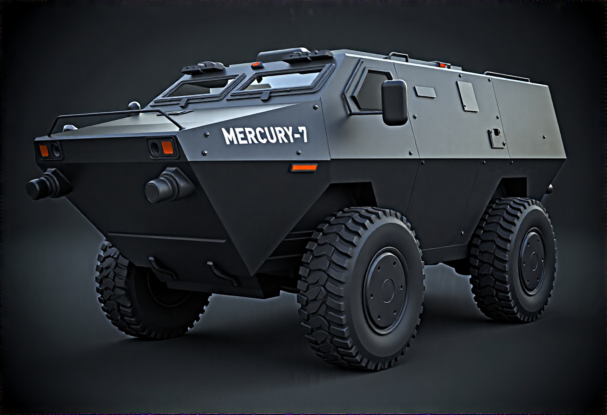
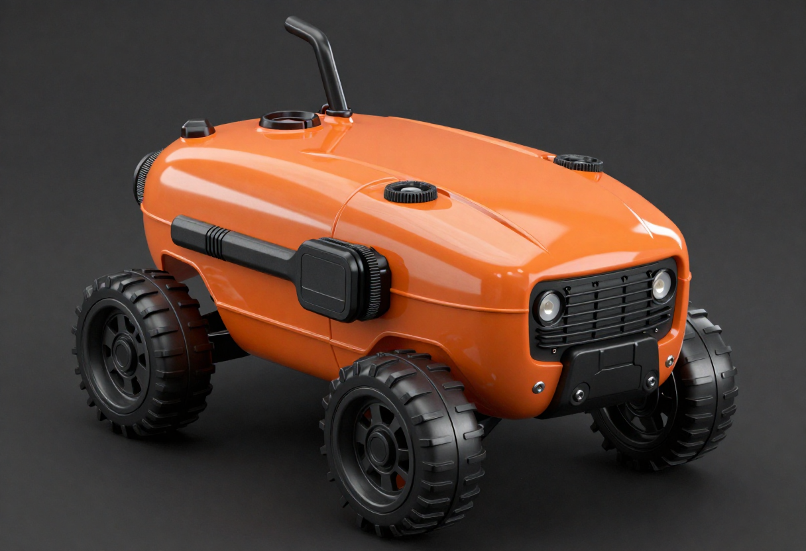
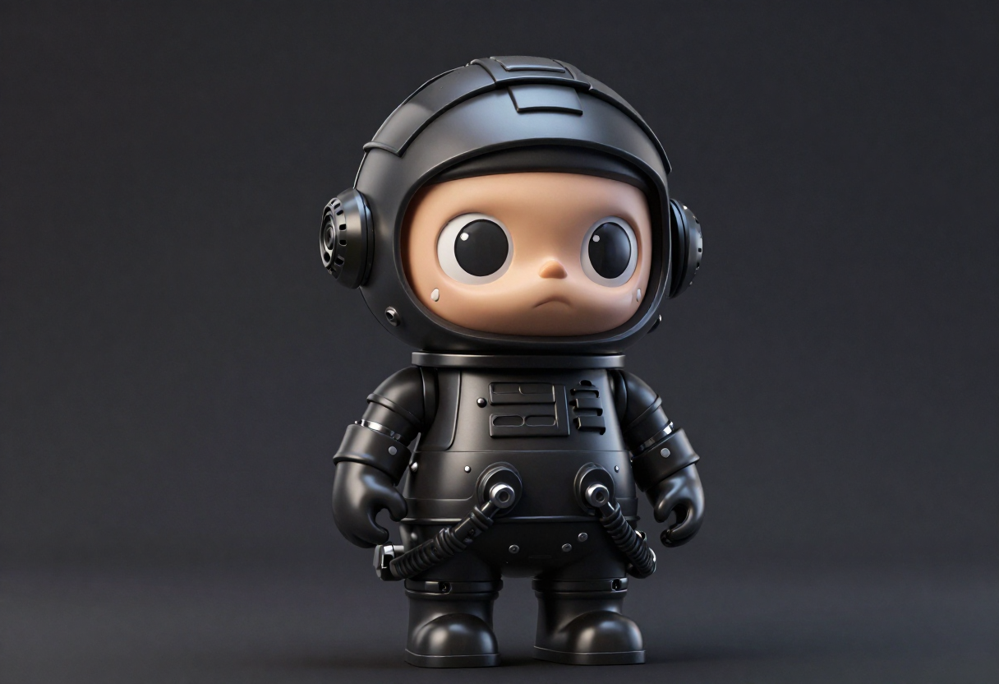
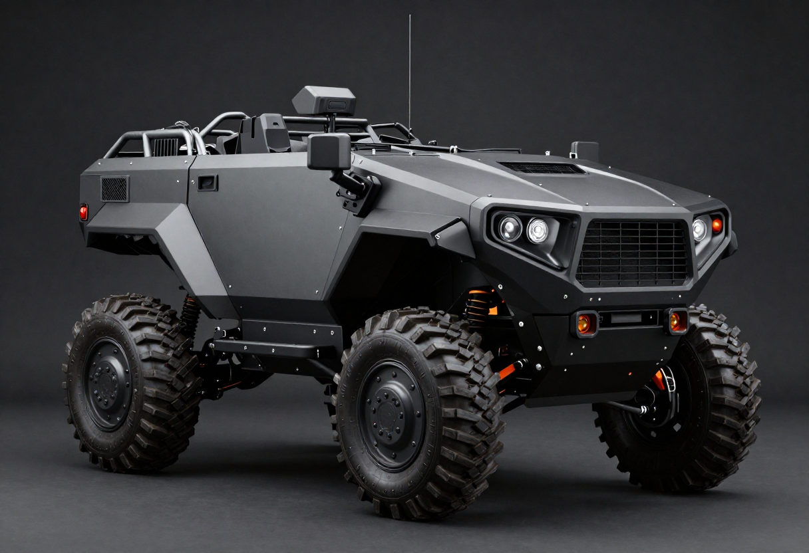

# Self-correction loop — generate → judge → refine

The self-correction loop turns Chimera from "**generate once**" into "**iterate to a
passing result**": render a candidate, judge it against a brand/brief rubric, feed the
unmet criteria back into the prompt, regenerate — until a candidate passes or a
max-iteration cap is hit. It is the orchestration layer that sits on top of Brand Kits
generation, distinct from the [MCP bridge](README.md) (which is the assistant→ComfyUI
transport).

## The shared core — `scripts/agent/`

A small, **model-free, judge-agnostic** core (unit-tested with no GPU/ComfyUI). It
reuses the existing `scripts/generate.py` filler/route path. Only the **winning**
render is recorded — with an *agent-run* sidecar (`kind: agent-run`) summarizing the
run (subject, iterations, pass/score, winning seed/prompt, and `corrected_subject` when a branded run
dropped flagged styling from the subject). That sidecar is a run
summary, **not** a replayable render sidecar: `generate.py replay` refuses it on the
`kind` discriminator. Per-iteration renders are routed into the brand folder but are
not individually sidecar'd, so the loop is **not** per-iteration replayable.

| Module | Responsibility |
|---|---|
| `rubric.py` | `Rubric` + `build_rubric(manifest, subject)` — composes a scorable checklist from the brand (subject, style, palette, negative). `rubric.as_prompt()` renders the numbered **MET / NOT-MET → PASS/FAIL → `score: 0-1`** instructions a judge follows. With a brand, the subject criterion judges the object itself and the brand wins any styling conflict; a FIX may never contradict another criterion. Palette colors are named for the judge (`color_words`: `#1c1f22` → `near-black (#1c1f22)`), since a VLM can't read hex. |
| `expander.py` | `PromptExpander` ABC + `TemplatedExpander` — wraps `build_prompt(manifest, subject)` for the on-brand `(positive, negative)`. On a correction pass it applies the judge's `FIX: add …; avoid …` directives (`parse_fixes` reads either order, `remove …`, `none needed`), after `brand_guard` drops contradictions: never add a trait an avoid term or the brand's negative names, never avoid the brand's own style or palette. |
| `judge.py` | `Verdict(passed, score, issues)` + `Judge` ABC (`judge(image_path, rubric) -> Verdict`) + `parse_verdict(text)` — a robust free-text → `Verdict` parser (word-boundaried PASS/FAIL, clamped score, `4 out of 5` / `7` / `85` rescaled to 0–1, NOT-MET lines → issues; a criterion whose status is NOT-MET fails the verdict even under an "Overall: PASS"; never raises). The status is the first MET / NOT-MET word on a criterion's line or a table cell holding only it, in any common form (`1. Subject — NOT-MET`, `**Palette**: NOT_MET`, `| 2 | … | NOT-MET |`, `1 NOT-MET` in a summary), while `NOT MET: none` and a MET reason that mentions "unmet" don't count. |
| `loop.py` | `run_loop(*, expander, judge, generate, manifest, subject, rubric=None, max_iters=4, seeds=None) -> LoopResult` — the heart. Judge-agnostic: `generate` and `judge` are **injected callables**. Threads prior issues forward; returns early on PASS, else the best-scoring candidate after the cap, with full per-iteration history. In branded runs it also drops the subject styling the judge flagged from the subject **and** the rubric (`correct_subject`; the object phrase is kept), so later passes aren't judged against the off-brand words. |

The judge's **PASS/FAIL verdict is authoritative** for stopping the loop — a single
PASS returns immediately. The `score` is *not* a threshold gate; it is used only to
**rank candidates** when the iteration cap is reached and the loop returns the
highest-scoring one. A mid-iteration render/judge failure is caught and recorded as a
failed candidate (score `0.0`, no image), so one bad iteration never aborts the run and
a failed candidate can never win.

The two pluggable seams are the **`Judge`** interface (how a candidate is scored) and
the **`PromptExpander`** interface (how a subject + prior issues become a prompt).
Everything else — the rubric, the loop, the generate path — is shared by both backends
below. `TemplatedExpander` is the default expander; an LLM-driven expander (`LLMExpander`,
opt-in via `--rewrite-prompts`) now ships alongside it — it rewrites prompts from the judge's
FIX feedback and falls back to `TemplatedExpander` on any LLM error.

## The three judge backends

All drive the *same* core; they differ only in **who plays the `Judge`**.

| | **Local ComfyUI node (opt-in)** | **API (provider-agnostic, default)** | **Assistant Workflow** |
|---|---|---|---|
| Judge | the optional ComfyUI **Qwen3-VL** judge node | **Any OpenAI-compatible LLM** (`LLMJudge`, N-pass consensus via `--judge-passes`) — by default a local **Ollama** model sized to the GPU ([tiers](#local-models-by-gpu-tier)) | The assistant's own vision — M passes, majority-PASS consensus |
| Driver | `auto_generate.py --backend local` (ComfyUI node) | `auto_generate.py` (`--backend api` is the default; `--judge-*` / `--llm-*` or `CHIMERA_*` point it elsewhere) | an interactive agent (Claude Code Workflow tooling); `auto_generate.py` refuses `--backend assistant` |
| Cost / deps | ~6–9 GB VRAM (8B), **offline/unattended**; needs the optional, unpinned ComfyUI-QwenVL pack | API or **local** endpoint (Gemini/OpenAI/Anthropic/**Ollama**, 4.4–16.5 GB by tier) — no SDK | No API key, no extra model |
| Status | **Built + validated** (full loop ran live) | **Built + validated** (live Ollama: Qwen3-VL vision judge) | **Built + proven** (live fail→pass below) |
| Recipe | `scripts/agent/auto_generate.py` | §[Bring your own LLM](#bring-your-own-llm---backend-api----pipeline-cad) | [`../../workflows/agent/README.md`](../../workflows/agent/README.md) |

**When to use which:**

- **Assistant Workflow** — highest-quality, subtle-correctness briefs (anatomy,
  layout, counts, "no X"), when you can keep the assistant in the loop. The multi-judge
  consensus is the strongest available filter. Recipe + the proven chimera-anatomy
  precedent: [`../../workflows/agent/README.md`](../../workflows/agent/README.md).
- **`auto_generate.py`** (the default Ollama judge, or the opt-in ComfyUI node) — unattended batches,
  scheduled jobs, or fully **offline** runs with no assistant present. Trades a touch of judging quality
  for autonomy.

### Multi-judge consensus — `ConsensusJudge`

The majority-vote consensus above is now a concrete, judge-agnostic `Judge`:
[`scripts/agent/judge.py`](../../scripts/agent/judge.py)'s `ConsensusJudge` wraps **N sub-judges**
and combines them — `passed` = a strict majority passed, `score` = the mean, `issues` = the
de-duplicated union of every sub-judge's unmet criteria (so the expander addresses *all* raised
concerns on the next iteration). A sub-judge that raises counts as a fail rather than crashing the
panel. The diversity comes from the judges you pass in (different VLMs/prompts, or an assistant
panel) — all behind the same `Judge` seam, so it drops straight into `run_loop`. Unit-tested in
[`tests/test_consensus.py`](../../tests/test_consensus.py).

### Local backend

> **Status: built + live-validated.** The full generate → judge → refine loop has run
> end-to-end: a Z-Image render judged against the auto-built brand rubric, returning
> `passed=True score=0.97`. The judge is now served by Ollama through `--backend api`, the
> default, as a model picked for the GPU ([Local models by GPU tier](#local-models-by-gpu-tier));
> the ComfyUI judge node is the opt-in `--backend local` alternative.

`auto_generate.py` runs the **same** `run_loop` with a VLM judge in place of the assistant's
vision. By **default** (`--backend api`) that judge is a local **Ollama** model sized to your GPU:
**`qwen3.8:27b`** with thinking off on a 24 GB+ card, `qwen3-vl:8b-instruct` on 12–24 GB and
`qwen3-vl:4b-instruct` below that ([Local models by GPU tier](#local-models-by-gpu-tier)). With no
`--judge-*` / `--llm-*` flag and no `CHIMERA_*` variable set, it calls `http://127.0.0.1:11434/v1` (or
`$OLLAMA_HOST`), and any of those settings replaces that default. A judge you choose should be a
**non-thinking** `-instruct` VLM or a hybrid model with thinking off: a *thinking* model can spend its token
budget on reasoning and return empty content. It needs no ComfyUI node pack. With `--backend local` the
judge is instead the optional ComfyUI node, run **as a ComfyUI graph** (the same queue/`ComfyClient` path
every Chimera modality uses):
`LoadImage → Qwen3-VL(prompt = rubric.as_prompt()) → text`, then `parse_verdict()` turns that text into a
`Verdict`. The expander is the same deterministic `TemplatedExpander`, so a local run is brand-aware
without any assistant or API key.

**Invocation:**

```
python scripts/agent/auto_generate.py [--brand <brand>] --subject "<subject>" \
    --comfy-output-dir <ComfyUI output dir> [--max-iters N] [--seeds a,b,c]
```

Without `--seeds`, each run draws fresh seeds and prints them (outputs are named by seed, so a fixed
default let a second run replace the first run's winner); pass them back with `--seeds` to repeat a run. A
shorter `--seeds` list is topped up with fresh seeds, and a seed the run repeats (`--seeds 7,7,7`, one seed
with corrected prompts) gets its own files per pass: `agent_7`, `agent_7_2`, `agent_7_3`.

`--brand` is **optional** — the same machinery does branded *and* general self-correction:

- **With `--brand`** — `build_rubric` adds the brand's style/palette/negative criteria, so the
  loop enforces brand conformance and the winner routes into `brands/<brand>/outputs/`.
- **Brandless** (omit `--brand`) — the manifest is the neutral `default_manifest()`, so the rubric
  collapses to just *"clearly depicts {subject}"* + *"high quality (sharp, well-composed, no
  artifacts)."* That's a general QA gate — reject blurry / wrong-subject / artifact-ridden renders —
  and the winner routes into the global `outputs/`. The judge, expander and loop are brand-agnostic;
  only the rubric's optional criteria differ.

`--comfy-output-dir` is where finished renders route from (into the brand folder, or the global
`outputs/` when brandless); with `--backend local` it is also where the judge graph drops (and the
judge reads back) its verdict `.txt`.

### The judge & correction in action (real local-backend output)

The strict judge **enforces the brand** — it passes an on-brand render and rejects an off-brand one
(both judged live by the Qwen3-VL judge against the `example-brand` rubric):

| Judge **PASSED** — 0.95 | Judge **REJECTED** — 0.70 |
|:---:|:---:|
|  |  |
| dark tactical hull, legible "MERCURY-7", brand palette | *"playful, childlike… toy-like rather than rugged tactical-industrial"* |

The rubric is **strict** (overall PASS only if *every* criterion is MET) and asks the judge to attach
a structured fix to each miss — `FIX: add <…>; avoid <…>`. The expander consumes that directly:
`add` terms are emphasized in the next positive prompt; `avoid` terms are **stripped from the subject**
in the positive (the image recipes sample at CFG 1, so the positive is the real lever) and also pushed
to the negative for graphs that sample above CFG 1. See `scripts/agent/expander.py`.

**When the subject fights the brand.** A subject such as *"a glossy candy-red toy rover"* under a gunmetal
brand used to stall the loop: the subject criterion demanded the candy colors while the brand criteria
forbade them, so a small judge wrote contradictory fixes (*"add cartoonish toy styling; avoid matte
black"*) and every pass drifted further off-brand. Three changes (v0.6.0) make the brand win. The rubric
says so. `brand_guard` filters the contradictions out of the FIX terms. And the loop removes the
flagged styling from the subject and the rubric before the next pass, keeping the object itself.

**The judge evaluates every criterion and emits an actionable fix.** Verbatim from the Qwen3-VL judge on an
`example-brand` rover render:

```
1. MET — six wheels arranged in two rows of three, providing stability typical of military vehicles…
2. MET — robustly built with sharp angles consistent with industrial designs…
3. NOT-MET  FIX: add subtle highlights reflecting light off metallic surfaces;
            avoid overly smooth textures that might suggest plastic models rather than real metal
4. MET — dominant colors match those specified (#1c1f22, #2e3338)…
5. MET — clear details, no blurring…
```

That `FIX: add … ; avoid …` is exactly what the expander turns into the next prompt.

**It enforces the brand.** Given a deliberately off-brand *"glossy orange plastic toy rover,"* the
strict judge rejects it (and explains why), where the old lenient pass-bar would have rubber-stamped it:

```
NOT-MET — a playful, childlike appearance that aligns more closely with "toy-like" than with
          rugged tactical-industrial / precise engineering themes.
NOT-MET — lacks the specified palette colors like #1c1f22 …
Overall: FAIL   score: 0.7
```

…versus an on-brand render the same judge passes at **0.95–0.97**.

### A real fail→pass — the assistant consensus backend *correcting* an off-brand render

Enforcement is half the loop; the other half is **correction**. Below the loop is driven by the
**assistant consensus backend** — the agent's own vision, **M = 3 independent passes** combined by
[`consensus_verdict`](../../scripts/agent/judge.py) — against the `example-brand` rubric for subject
*"a six-wheeled exploration rover"*. **Same subject, same seed (7), same real pipeline; only the brand
correction changes** — one rover, taken from a glossy toy finish to on-brand tactical armor:

| iter 0 — consensus **FAIL · 0.38** (3/3 FAIL) | iter 1 — consensus **PASS · 0.92** (3/3 PASS) |
|:---:|:---:|
|  |  |
| a six-wheeled rover in **glossy candy-red/yellow toy** finish — fails *style*, *palette*, *avoids toy-like* | the **same six-wheeled rover** in gunmetal + matte-black tactical armor, rust accent — **every criterion MET** |

The first prompt was deliberately off-brand (*"a six-wheeled exploration rover vehicle, bright glossy
candy-red and sunny-yellow plastic bodywork, smooth rounded cartoonish toy styling, … pastel colors"*).
Each of the three vision passes marked it FAIL with a structured fix; `consensus_verdict` unioned their
issues, and the **real `TemplatedExpander`** turned them into the iter-1 prompt — stripping `glossy,
candy-red, sunny-yellow, toy, rounded cartoonish, pastel` from the subject and leading with *"Correct
the previous attempt — render strictly in the rugged tactical-industrial style…"* plus the emphasized
`add` terms (matte gunmetal, hard angular faceted panels, weathered, photoreal). Re-rendered at the
**same seed**, the consensus judge passed it 3/3. **The subject never changed — it is a six-wheeled
rover in both frames — so what you see corrected is the *brand*, not the object.** That is the loop
doing what it is for: **turning a genuine miss into an on-brand pass**, not merely rejecting.

One of the three passes for each frame, **verbatim** (the texts `consensus_verdict` parsed and combined
— same format the local-judge section above quotes, except here the judge is the agent's own vision, so
read the score as the agent's self-assessment, not a third-party metric):

```
# iter 0 — one of three FAIL passes
1. avoids toy-like/cartoonish: NOT-MET - unmistakably a glossy plastic kids toy.
   FIX: add rugged matte tactical hardware; avoid toy-like, glossy plastic, cheerful, rounded cartoonish
2. high quality (sharp, well-composed): MET - sharp and clean.
Overall: FAIL   score: 0.4

# iter 1 — one of three PASS passes
1. clearly depicts a six-wheeled exploration rover: MET - a six-wheeled armored rover, three wheels per side.
2. style matches rugged tactical-industrial, gunmetal, matte black, hard edges, photoreal: MET -
   angular faceted armored hull, photoreal hardware render.
Overall: PASS   score: 0.94
```

The headline **0.38 / 0.92** are the **mean of each frame's three self-assessed passes**
(`consensus_verdict` averages them); the per-pass scores above are the individual votes.

### The same correction, fully local: the Ollama judge (v0.6.0)

The README's headline GIF is the autonomous loop with no assistant in it: Qwen3-VL-8B-Instruct on a local
Ollama judging with 3-pass consensus, on Qwen-Image-2.1. The command that reproduces it names the judge,
since the default now depends on your [GPU tier](#local-models-by-gpu-tier): `auto_generate.py --pipeline
image --brand example-brand --judge-model qwen3-vl:8b-instruct --judge-passes 3 --seeds 7,7,7
--comfy-output-dir <dir>`, with the deliberately off-brand subject *"an exploration rover vehicle, bright glossy candy-red and sunny-yellow
plastic bodywork, smooth rounded cartoonish toy styling, cheerful kids' toy, pastel colors"*:

| iter | verdict (one of three passes, verbatim) | before the next pass |
|---|---|---|
| 0 | FAIL · 0.40 — *"The image is cartoonish and toy-like, which conflicts with the requirement to avoid these traits. FIX: add none; avoid cartoonish, toy-like."* | the cartoonish toy-styling phrase leaves the subject and the rubric |
| 1 | FAIL · 0.49 — still glossy red-and-yellow plastic, *"more toy-like … not rugged tactical-industrial"* | the candy-colored plastic, kids'-toy and pastel phrases leave too |
| 2 | **PASS · 1.00** | — |

Iteration 2's subject was just *"an exploration rover vehicle"* inside the brand's style, on the same seed
throughout. Before v0.6.0 this run never converged. The judge kept demanding the candy colors (the
subject criterion) while forbidding them (the brand criteria), and its contradictory fixes pushed each
pass further off-brand.

**Honest note on convergence — and which backend earns it.** The default image model plus brand prompt
injection are strong enough that a *satisfiable* subject often passes on the **first** iteration, so a
dramatic fail→pass appears only when a render genuinely misses the brand (as above, where the first
prompt was deliberately off-brand). Reliability scales with the judge. The **assistant consensus
backend** earns that fail→pass cleanly: three independent vision passes yield a strict verdict and
precise fixes. The **local Qwen3-VL-8B judge** writes noisier fixes, and it can miss fine geometry (it
passed a fan rotor whose blades floated free of the hub; the geometry gate now catches that). With
v0.6.0's brand-precedence rubric, tolerant FIX parsing and subject correction, it converges on brand misses
like the one above. (The 8B is now the medium tier's judge. On a 24 GB+ card the default is Qwen 3.8 27B,
which caught the fine-perception cases the 8B missed in the
[benchmark](#measured-on-the-rtx-5090-2026-10-15).) Choose the backend per job: `auto_generate.py` with the
default local Ollama judge for hands-off batches, and the assistant consensus backend (an interactive agent following
[`../../workflows/agent/README.md`](../../workflows/agent/README.md); `auto_generate.py` refuses
`--backend assistant`) when you want the strongest correction.

### …and it works **without a brand**, too — correcting *content*, not style

Drop `--brand` and the **same loop runs brandless**: `default_manifest()` collapses the rubric to
*"clearly depicts {subject}"* + *"high quality"* (no style/palette criteria), and the expander's
correction carries **no brand lead** — just `"Correct the previous attempt. {subject}. Ensure these
are present: …"`. Here the subject is a **chimera** — *a lion's body, a goat's head rising from its
back, and a serpent-headed tail* — and the miss is **content**, not brand:

| iter 0 — consensus **FAIL · 0.59** (3/3 FAIL) | iter 1 — consensus **PASS · 0.91** (3/3 PASS) |
|:---:|:---:|
|  |  |
| lion body ✓ + goat head from the back ✓, but the **tail is an ordinary lion tail** — *"clearly depicts {subject}"* NOT-MET | the loop grew the **serpent-headed tail** — all three parts present, both criteria MET |

The judge's verbatim miss and fix (same `consensus_verdict`, brandless rubric):

```
1. clearly depicts the full chimera (lion body, goat head from the back, serpent-headed tail):
   NOT-MET - the tail is a plain tufted lion's tail, not serpent-headed.
   FIX: add a serpent's head at the tip of the tail, a scaled snake-headed tail; avoid plain lion tail
Overall: FAIL   score: 0.6
```

The expander folded that into `"…Ensure these are present: a serpent's head … at the tip of the
tail"` and the re-render grew the serpent tail. Note the **contrast with the branded demo above**: the
branded rubric corrected *style* (toy → tactical) because a brand *defines* a style; the brandless
rubric has no style criterion, so it corrected *content* (the missing tail) and left the rendering
style free (here it drifted photoreal → illustration — correct brandless behavior). Same machinery,
two jobs: **enforce a brand, or just make the render actually depict what you asked for.** Run it with
`python scripts/agent/auto_generate.py --subject "…" --comfy-output-dir …` (no `--brand`).

**How the verdict is captured (optional ComfyUI judge path):** the judge graph
(`workflows/templates/agent-vlm-judge.json`) runs Qwen3-VL via the
`AILab_QwenVL_Advanced` node and writes its text output to disk with the **core**
ComfyUI node `SaveImageTextDataSetToFolder` (`comfy_extras.nodes_dataset`), which lands
`agent_verdicts/<prefix>_00000.txt`; `LocalVLMJudge` reads that file (run-unique prefix,
brief retry for the FS flush) and feeds it to `parse_verdict()`. That save node is
`experimental` and ships in core ComfyUI — it is **not** a separate node pack — so it
requires **ComfyUI ≥ 0.24.x**. This ComfyUI-QwenVL judge is now **opt-in** (`--backend local`) — the
default is a local **Ollama** judge picked for the GPU (`--backend api`), which needs no node pack at all.

- **Model:** the Ollama judge comes from the [GPU tier](#local-models-by-gpu-tier). The node path runs
  `Qwen/Qwen3-VL-8B-Instruct` (Apache-2.0; the `-instruct`, non-thinking variant), with weights in
  `models/LLM/Qwen-VL/` (catalogued in [`../../docs/CATALOG.md`](../../docs/CATALOG.md)).
- **Node pack (optional):** [`1038lab/ComfyUI-QwenVL`](https://github.com/1038lab/ComfyUI-QwenVL)
  is **no longer the default/auto-checked pin** — it's an optional alternative to the Ollama judge.
  Before using it, **re-pin to a Qwen3-VL-capable commit (≥ v1.0.4) and re-scan**; the previously
  audited commit `fcd1ada` predates Qwen3-VL support.

**VRAM / perf:** judging adds a model load + inference per candidate, so a multi-seed batch is
meaningfully slower than a plain generate. The Ollama judge's size follows the
[GPU tier](#local-models-by-gpu-tier), from 4.4 GB (the 4B) to 16.5 GB (Qwen 3.8 27B); the measurements
there show why the 32B and 30B-A3B Qwen3-VL sizes are not defaults.

**Security posture:** the node path's weights come from the **official Qwen repo**
(`Qwen/Qwen3-VL-8B-Instruct`, Apache-2.0) only; the Ollama judges are pulled by tag from Ollama's library.
The optional ComfyUI-QwenVL node pack, if used,
must be **pinned** (no `@latest`) to a re-audited Qwen3-VL-capable commit (≥ v1.0.4),
consistent with the rest of Chimera's third-party-code policy (same standard applied to the
[MCP bridge](README.md) and the foley pack). Re-audit before any pin bump.

## Local models by GPU tier

A role with nothing configured (no `--judge-*` / `--codegen-*` / `--rewriter-*` flag, no shared `--llm-*`, no
`CHIMERA_*` variable) falls back to a model Chimera picks, on the local Ollama (`http://127.0.0.1:11434/v1`,
or `$OLLAMA_HOST`). The defaults were chosen on an RTX 5090 (32 GB) and most cards have less, so they come in
three tiers picked from the GPU's memory, and smaller cards get lighter judges automatically:

| Tier | GPU memory | Judge | Rewriter (`--rewrite-prompts`) | CAD code-gen (`--pipeline cad`) |
|---|---|---|---|---|
| **large** | 24 GB+ | `qwen3.8:27b` (thinking off) | `qwen3.8:27b` | `qwen3.8:27b` |
| **medium** | 12–24 GB | `qwen3-vl:8b-instruct` | `qwen3-vl:8b-instruct` (the judge's model, so nothing extra loads) | `qwen3.8:27b`, partly on the CPU |
| **small** | under 12 GB | `qwen3-vl:4b-instruct` | `qwen3-vl:4b-instruct` | `qwen3.8:27b`, mostly on the CPU (slow; point `--codegen-*` at a hosted model if you have one) |

- **How the tier is picked.** The GPU's total memory comes from ComfyUI (`/system_stats`) when it answers,
  else from a time-limited `nvidia-smi`. The cut-offs in code are 22 and 11 GiB, since a 24 GB card reports
  23.99 GiB. If neither answers, the run takes the medium tier and says so.
- **Choosing one.** `--llm-tier auto|large|medium|small`, or `CHIMERA_LLM_TIER` (the flag wins; `auto` picks
  from the GPU). Anything you configure for a role still beats its tier model, in the usual order: role flag >
  `CHIMERA_<ROLE>_*` > shared `--llm-*` > `CHIMERA_LLM_*` > tier. Each setting resolves on its own, so a base
  URL set without a model gets the tier's model name.
- **Thinking.** Qwen 3.8 is a hybrid thinking model. As a tier default it runs with
  `reasoning_effort: "none"`, as benchmarked; a model you configure is never sent that default.
- **What ran.** A run that falls back to tier models prints them, e.g. the CAD loop on a 32 GB card:
  `[agent] local models, large tier (32 GB GPU): judge qwen3.8:27b, code-gen qwen3.8:27b (--llm-tier to change)`.
- **Pulling the models.** `chimera doctor` reports the tier, whether Ollama has its models, and the exact
  `ollama pull` commands for any that are missing:

  | Tier | Pull |
  |---|---|
  | large | `ollama pull qwen3.8:27b` |
  | medium | `ollama pull qwen3-vl:8b-instruct` (+ `ollama pull qwen3.8:27b` for the CAD loop) |
  | small | `ollama pull qwen3-vl:4b-instruct` (+ `ollama pull qwen3.8:27b` for the CAD loop) |

- **No configuration needed.** The CAD loop (`--pipeline cad`) used to stop and ask for
  `CHIMERA_LLM_BASE_URL`; with nothing set it now runs on the tier's models, as does `--rewrite-prompts`.

### Measured on the RTX 5090 (2026-10-15)

**Judge.** 34 cases with labels checked by eye: 11 plain ones and 23 hard ones that match most of the brief
but miss one visible thing (a misplaced logo icon, two robots instead of three, a monitor in a "nothing else
in frame" product shot, a missing raincoat, the wrong view angle, off-brand toy colors, two goat heads instead
of one, a stray rod or floating slivers the 3D rubric fails). Each judge ran every case 3 times through
Chimera's own judge code. Balanced accuracy is the mean of the right-PASS and right-FAIL rates.

| Judge | Correct of 34 (mean of 3 runs) | Balanced accuracy | Per judgment | GPU memory |
|---|---|---|---|---|
| `qwen3.8:27b` (large tier) | **31.0** | **0.900** | 1.5 s | 16.5 GB |
| `qwen3-vl:32b-instruct` | 30.0 | 0.888 | 14.6 s | 21.1 GB |
| `qwen3-vl:8b-instruct` (medium tier) | 29.3 | 0.865 | 0.8 s | 6.6 GB |
| `qwen3.6:27b-coding` | 29.3 | 0.849 | 1.5 s | 16.3 GB |
| `qwen3-vl:4b-instruct` (small tier) | 27.7 | 0.817 | 0.6 s | 4.4 GB |
| `qwen3-vl:30b-a3b-instruct` | 27.3 | 0.801 | 0.7 s | 18.7 GB |

Qwen 3.8 27B caught the three fine-perception cases (the stray rod, the floating slivers, the misplaced logo
icon) that the 8B missed on every run. The 32B came close at about ten times the time per judgment, and the
30B-A3B MoE scored below the 4B.

**CAD code-gen.** The real CAD loop on six parts (a cable organizer, a wall hook, a hex-key holder, a 12-blade
fan rotor in a shroud, a phone stand and a 20-tooth spur gear), with the same judge (`qwen3-vl:8b-instruct`),
the same seeds and up to 3 iterations each:

| Code-gen | Passed | First try | Missed |
|---|---|---|---|
| `qwen3.8:27b` | **5 of 6** | 3 | the fan rotor |
| `qwen3.6:27b-coding` | 4 of 6 | 2 | the wall hook, the hex-key holder |
| `qwen3.5:9b` | 0 of 3 (run on the first three parts only) | 0 | all three |

Qwen 3.8 27B also hit fewer script errors (2, against 4 for the coding model). A light 9B is not a usable
code-gen, so every tier keeps the 27B, and a smaller card runs it partly on the CPU: slower, but the same
model.

## 3D self-correction (Phase 3) — `--pipeline mesh3d`

The same loop now corrects **3D meshes**. `auto_generate.py --pipeline mesh3d` runs:

```
subject ─► txt2img concept ─► 3D mesh ─► Blender mesh_eval (4 orbit stills + geometry probe)
        ─► contact-sheet PNG ─► VLM form judge (+ geometry checks) ─► FIX ─► refine ─► repeat
```

**Which 3D model (since 2026-10).** The mesh comes from `--mesh-model` (else the brand's `threed.model`,
else the default **TRELLIS.2**):

- **TRELLIS.2 (default) / Pixal3D** bake PBR textures natively, so the stills show the textured model and
  the loop uses the **textured rubric** (form criteria plus a lenient color criterion).
- **`--mesh-model hunyuan21`** gives the original shape-only flow described below, and is **required for
  `--texture` and `--finalize`**. Those Blender bakes color a shape-only mesh; on an already-textured mesh
  they would overwrite its textures, so the loop refuses them up front.
- `--model` is only the **concept image's** model. Until 2026-10 it leaked into the 3D build as the
  Hunyuan3D checkpoint, which made every mesh3d iteration fail validation.

It reuses the **model-free core unchanged** — `run_loop`, `parse_verdict`, `TemplatedExpander`,
`ConsensusJudge`. Only three pieces are new:

| Piece | What |
|---|---|
| `scripts/agent/render_generate.py` | `make_render_generate(...)` — the `generate(pos, neg, seed)` closure: txt2img concept (or `--from-image`) → upload → 3D mesh from `--mesh-model` (routed to `outputs/3d`) → headless `mesh_eval.py` render+probe → host-side contact-sheet montage → returns the **contact-sheet PNG** the judge consumes. |
| `workflows/templates/blender/mesh_eval.py` | bpy template: import mesh → 4 orbit Cycles stills → **bmesh geometry checks** (non-manifold / open-edge / loose-part / tri-count / bounds) → emits both in its manifest. |
| `scripts/agent/judge.py` `GeometryAwareJudge` | wraps any `Judge`; reads the `<stem>.checks.json` the generator writes and **forces FAIL + unions structural NOT-MET issues** on any geometry defect (things a VLM can't see from a render). |

**Form, not color (shape-only meshes).** Hunyuan3D output is **untextured grey clay**, so with
`--mesh-model hunyuan21` `build_rubric(manifest, subject, modality="3d")` scores *form* — recognizability,
proportions/silhouette, completeness (no missing/broken/fused parts), clean surface — and **drops the
color/palette criteria**. (Texturing is Phase 4; the textured models add one color criterion.)

**The lever is the concept image.** Every 3D model here is image-conditioned (no text prompt steers the mesh
graph), so the expander's `FIX` directives steer the **concept** prompt, and a fresh mesh is lifted from
it each iteration. Two failure modes self-route: an *actionable* visual miss (wrong proportions, a
missing part) folds into the next concept prompt; a *lift-lottery* defect (a melted back, a hole)
usually yields no steerable FIX, so the concept holds steady while the loop's advancing seed **rerolls
the mesh**. `--from-image` fixes the concept outright and makes the loop a pure mesh-reroll (the
"character image → 3D model" path).

**What the judge sees.** A single **contact sheet** of 4 orbit views (montaged host-side via
`scripts/brandkit/montage.py`), so the VLM catches back/side defects a single hero view would hide.
`mesh_eval` also computes geometry facts (non-manifold/open edges, loose parts, tri-count, bounds) and
records them in a `.checks.json` sidecar. `structural_issues` injects only the **gross, VLM-invisible**
ones as pre-judged NOT-MET issues — an **empty/degenerate mesh** or one that **fragmented into many
islands** can never PASS, however good the contact sheet looks. It deliberately does **not** fail on
non-manifold or open edges: a live run showed raw Hunyuan3D output is inherently ~34% non-manifold (even
at zero weld) with some boundary edges — baseline for surface-net extraction, not a defect — so gating on
them rejected every real mesh. They stay in the sidecar for provenance (`DEFAULT_MAX_LOOSE_PARTS`, the
fragmentation threshold, is tunable).

**Backends.** Same `--backend` as the image loop: `api` (the **default**: the GPU tier's local Ollama judge) or
`local` (the optional ComfyUI Qwen3-VL judge node over the contact sheet). The assistant consensus (the
agent judges the contact sheet with M vision passes) runs with an interactive agent — see
[`../../workflows/agent/README.md`](../../workflows/agent/README.md); `auto_generate.py` refuses
`--backend assistant`.

**Cost.** A mesh3d iteration runs two ComfyUI graphs + a Blender render, so `--max-iters` defaults to
**3** (vs 4 for image); `--blender-timeout` budgets the render independently of the ComfyUI `--timeout`.

**Invocation:**

```
python scripts/agent/auto_generate.py --pipeline mesh3d --subject "an armored knight on horseback" \
    --comfy-output-dir <ComfyUI output dir> [--brand <brand>] [--from-image concept.png] \
    [--mesh-model trellis2|pixal3d|hunyuan21] [--octree 256] \
    [--samples 48] [--res 640 640] [--max-iters 3] [--backend api|local]
```

`--backend api` is the default; `--octree` applies only to `--mesh-model hunyuan21`. The winner's mesh
lands in `outputs/3d/` (or `brands/<brand>/outputs/3d/`); the judged contact sheet and the `agent-run`
sidecar (`modality:"3d"`, `winning_seed`) land in the images folder beside it.

> **Status: built, GPU-free CI tested, and live-validated end-to-end (2026-06-14, Blender 5.1.2 /
> RTX 5090).** The full **autonomous** loop ran concept (Z-Image) → Hunyuan3D mesh → `mesh_eval`
> contact sheet → **real VLM judge** + geometry gate → accept, returning **PASS score 0.95**
> on a clean armored-rover mesh; the Phase-4a `--texture` path was validated on a knight helmet
> (front-faithful red/gold albedo, palette back). That first live run is what surfaced the over-strict
> geometry gate (raw Hunyuan3D is inherently non-manifold, so the old non-manifold/open-edge fail
> rejected every mesh) — now recalibrated to fail only on empty/degenerate/fragmented meshes. The
> earlier `mesh_eval` smoke had already caught + fixed a glTF vertex-split bug (watertight meshes read
> as thousands of loose parts).

### Phase 4a — front-projected albedo texturing (`--texture`)

`--pipeline mesh3d --texture` restores color to the loop via a **headless Blender bake** (pure
bpy/Cycles — it never touches the blocked `custom_rasterizer` path). Per iteration, before the orbit
renders, `_common.bake_albedo()`:

1. `smart_project`-unwraps the mesh into an albedo atlas (Hunyuan3D output is UV-less, so always unwrap);
2. projects the **concept image** (the same one that conditioned Hunyuan3D) from a dead-front camera —
   computed with `world_to_camera_view` per loop, because `bpy.ops.uv.project_from_view` needs a VIEW_3D
   region that doesn't exist under `--background`;
3. shader-masks **front-facing faces → concept** vs un-projected faces → a flat **`--back-fill`**
   (`palette` = `manifest.palette[0]`, the default; `mirror` = a back-projected flipped concept, for
   symmetric crest/relief subjects);
4. **EMIT-bakes** a `--texture-res` (default 1024) atlas, rewires it as Principled Base Color, and
   `mesh_eval` exports a self-contained **textured GLB**.

The stills are then colored, so the contact-sheet judge sees color. `build_rubric(..., textured=True)`
re-adds the color/palette criteria with **thrash-safe** wording — *"a plain or palette-filled back is
acceptable"* — so a genuinely wrong **front** color folds a `FIX` into the next concept prompt (color
self-correction, through the existing channel) while the loop never chases back texture a single front
image can't produce. A `<stem>.texture.json` sidecar records the textured status + GLB name.

**v1 honesty:** front-faithful, back palette-filled (or mirrored); the EMIT bake captures the concept's
lighting (lit-looking albedo, not delit). **Full loop live-validated end-to-end on the upgraded stack
(2026-06-27, ComfyUI 0.26.2 + Qwen3-VL-8B-Instruct judge):** concept → Hunyuan3D mesh → front albedo
bake → judge → refine ran clean and self-corrected (0.42 → 0.65 over 2 iters), emitting a `textured:true`
GLB. The result is **front-faithful with a grey/unpainted back by design** (one front image has no back
data) — for all-around colour use **`--finalize`** (Phase 4b multi-view auto-repaint, below). (Earlier
Blender-only smoke had already caught + fixed the headless `project_from_view` bug.)

### Phase 4b — all-around texture: multi-view bake engine + auto-repaint (both shipped)

Phase 4a's back is approximate because one front image has no back data. **Phase 4b** finalizes the
**winning** mesh once (not per iteration) with real all-around color. It splits into a multi-view bake
engine and a ComfyUI auto-repaint view-generator — both shipped:

**Shipped — the multi-view bake engine.** `generate.py finalize-texture --from <glb> --views
front,right,back,left` runs the `mesh_finalize.py` template, which calls **`_common.bake_multiview()`** —
a generalization of `bake_albedo` from 1 → N views: a ring camera per view, a per-view
`world_to_camera_view` projection UV, a per-view front-facing weight `max(0,dot(N,-dir))²`, a normalized
weighted blend `Σ(w·c)/max(Σw,ε)`, and a flat `--back-fill` for faces no view sees → EMIT-baked atlas →
textured GLB + orbit verification stills, routed to `outputs/` with a `mode:"finalize-texture"` sidecar.
Pure bpy/Cycles. **Live-validated on Blender 5.1.2 / RTX 5090** (a 4-distinct-colour-view bake of a sphere
put all four colours in the atlas — R 13 / G 14 / B 12 / Y 22 %). Today the N corrected views are
**supplied** (an artist's paints, or any source); this alone is a usable finalize step for the winning
mesh (its name is in the loop's `<sheet>.texture.json` sidecar).

**Shipped — the ComfyUI auto-repaint that generates the views.** `finalize-texture --auto-repaint
--concept  --subject "..."` finalizes without hand-painted views: `render_views.py` renders a per-view
**depth map** for the winning mesh → for each view an **SDXL depth-ControlNet** (lock geometry to that
depth) + **IPAdapter** (carry the concept's identity) graph (`scripts/brandkit/repaint.py`,
`repaint.generate_views`) paints a corrected view → the N views feed the shipped `bake_multiview`.
`--cn-strength`/`--ip-weight`/`--views-count` are tunable; the sidecar records the auto-repaint provenance.
Pure inference, **not** wheel-blocked (unlike in-ComfyUI Hunyuan3D-Paint, still stuck on the
cu130/torch2.10/sm_120 `custom_rasterizer` wheel — see [`../threed/README.md`](../threed/README.md)).
Models (all pinned/audited — see [`../../docs/CATALOG.md`](../../docs/CATALOG.md)): cubiq
`ComfyUI_IPAdapter_plus` @ `a0f451a` + `ip-adapter-plus_sdxl_vit-h` + `CLIP-ViT-H-14` +
`xinsir/controlnet-depth-sdxl-1.0`. **Live-validated on the RTX 5090:** an armored rover textured green/tan
all the way around. **Polish (shipped):** each repainted view is masked to its depth silhouette before
baking (the concept's background no longer bleeds onto edges), and views after the first add a second
IPAdapter pass on the previous painted view (`prev_weight`, default 0.4) for **cross-view consistency**.
A busy concept background still helps less than a plain one — lower `--ip-weight` if identity over-imposes.
**In-loop finalize (shipped).** `auto_generate.py --pipeline mesh3d --finalize` auto-runs the
`--auto-repaint` bake on the loop's winning mesh (recovered from the always-written `.texture.json`
sidecar, reusing its concept), re-judges the textured result against the `textured=True` rubric
(**informational, non-gating** — the shape already passed; texture is a finishing step), emits a
textured GLB + sidecar, and prints a copy-paste retry command so you decide whether to re-roll the
texture with a fresh seed. `--finalize-views` (1..7) tunes the ring; **mutually exclusive** with
`--texture` (the per-iteration front-albedo). Brand-optional. Non-fatal: a texturing/judge failure
leaves the untextured winner intact. The bake engine is shared with the CLI via
`scripts/brandkit/finalize.py` (`finalize_params` + `repaint_views`).

## CAD self-correction (FreeCAD, agent-authored script)

The same generate→judge→refine loop applies to **parametric CAD**, but the lever differs. Image→3D
varies the concept image + seed; CAD geometry is **deterministic**, so the lever is the **script itself**.

The loop: a brief → an **agent-authored FreeCAD Python script** → `generate.py cad --mode script
--script <file>` executes it headless into a BREP solid + STL → `generate.py render --mode mesh` renders
it → a VLM judges form/printability → the FIX feedback drives the **agent to revise the script** (e.g.
"handle too thin" → bump wall thickness) → re-execute, repeat. FreeCAD BREP output is manifold, but a
script can still build **disconnected bodies**: the local judge passed a fan rotor whose 16 blades floated
free of the hub. So since v0.6.0 the CAD loop applies the mesh3d **geometry gate** too, in strict mode
(`GeometryAwareJudge(strict=True)`): a scripted part must come out as **one** solid, so any separate body
fails with a `FIX: add one connected solid` the codegen acts on. (The mesh3d gate's 1%-of-the-mesh bar for
"significant" parts can't apply here: with fine tessellation the hub alone hid the blades under it.) `cad`
already validates dims host-side. FreeCAD 1.1 ships an unrelated top-level `App` package, so the script
runner resolves a script's own `import App` to FreeCAD.

**Two ways to drive the generator.** *Assistant-authored* (`cad --mode script`, the agent in Claude Code
writes/revises the script by hand) **or fully autonomous** via **`auto_generate.py --pipeline cad
--subject "..."`**, where a provider-agnostic LLM (below) writes + revises the FreeCAD script from the
loop's FIX feedback — `LLM script → cad --mode script → Blender contact sheet → judge → revise`, reusing
`run_loop`. With the default `--backend api`, `--pipeline cad` is a pure LLM+FreeCAD+Blender loop (no
ComfyUI) that needs no configuration: code-gen and judge fall back to the
[GPU tier](#local-models-by-gpu-tier)'s local Ollama models. With `--backend local` the optional ComfyUI
Qwen3-VL judge node is used instead (and ComfyUI runs only for judging).

> ⚠️ The autonomous loop **`exec`s LLM-authored scripts**. They run with restricted builtins + an import
> allowlist (`script_exec.py restrict=True`) behind a host-side denylist, which also rejects dunder-attribute
> walks (`.__globals__`, `.__class__`, `__subclasses__`, frame objects such as `f_globals`), and `FreeCADCmd`
> starts without credential-named environment variables (any name containing `KEY`, `TOKEN`, `SECRET`,
> `PASSW`, `CREDENTIAL` or `AUTH`), so a script can't read your API keys. It is still **not a sandbox**: Python
> object internals can reach `os`, and FreeCAD's own `Part.export`/`doc.saveAs` can write files. Point
> `--pipeline cad` only at a code-gen model you trust, on a machine you accept it touching.

### Bring your own LLM (`--backend api` / `--pipeline cad`)

Both the AI judge (`--backend api`) and the CAD code-gen are **provider-agnostic** — `scripts/agent/llm.py`
speaks the OpenAI-compatible `/v1/chat/completions` shape over stdlib HTTP (no vendor SDK), so any compatible
endpoint works. Configure via env (or `--llm-base-url`/`--llm-model`):

| Provider | `CHIMERA_LLM_BASE_URL` | `CHIMERA_LLM_MODEL` | key |
|---|---|---|---|
| **Google Gemini** (OpenAI-compat) | `https://generativelanguage.googleapis.com/v1beta/openai` | `gemini-2.5-pro` | `CHIMERA_LLM_API_KEY` |
| OpenAI | `https://api.openai.com/v1` | `gpt-4o` | `CHIMERA_LLM_API_KEY` / `OPENAI_API_KEY` |
| Anthropic (OpenAI-compat) | `https://api.anthropic.com/v1` | `claude-opus-4-8` | `CHIMERA_LLM_API_KEY` / `ANTHROPIC_API_KEY` |
| OpenRouter | `https://openrouter.ai/api/v1` | e.g. `google/gemini-2.5-pro` | `CHIMERA_LLM_API_KEY` |
| Local (Ollama / LM Studio / vLLM) | `http://localhost:11434/v1` | a local model | (omit) |

A vendor's own key (`OPENAI_API_KEY`, `ANTHROPIC_API_KEY`) is only ever sent to that vendor's host
(`https://api.openai.com`, `https://api.anthropic.com`); every other endpoint needs `CHIMERA_LLM_API_KEY` (or
`CHIMERA_<ROLE>_API_KEY`), so a globally exported OpenAI key can't reach OpenRouter or a LAN box. Each key
stays with its endpoint: `CHIMERA_<ROLE>_API_KEY` goes only to that role, and `CHIMERA_LLM_API_KEY` goes only
to the shared base URL's host (`CHIMERA_LLM_BASE_URL` or `--llm-base-url`) when one is set, else to every
role. The `Authorization` header is never forwarded on an HTTP redirect, and a key sent over plain `http://`
to a non-loopback host prints a warning.

Any OpenAI-compatible endpoint works — Gemini, OpenAI, Anthropic, OpenRouter, Groq, Together, or a local
server — because `LLMClient` only speaks `/v1/chat/completions`. For the vision **judge** the model must be
multimodal (Gemini, GPT-4o, Claude, or a local Ollama VLM such as the [tier defaults](#local-models-by-gpu-tier));
for CAD **code-gen** any chat model can be plugged in, but its strength decides the result (locally,
`qwen3.8:27b`, the code-gen in every tier, built 5 of 6 test parts and a 9B none of its 3).

**Per-role endpoints.** Each loop role takes its own endpoint/model, falling back to the shared `--llm-*`
above and then to its [GPU tier](#local-models-by-gpu-tier)'s local model (precedence: role-CLI > role-env >
shared-CLI > shared-env > tier, resolved by `client_for_role`): **codegen** (`--codegen-base-url`/`--codegen-model`,
`CHIMERA_CODEGEN_*`; `--pipeline cad`), **judge** (`--judge-*`, `CHIMERA_JUDGE_*`; any `--backend api` run),
**rewriter** (`--rewriter-*`, `CHIMERA_REWRITER_*`; `--rewrite-prompts` swaps the templated expander for
`LLMExpander`, which rewrites prompts from the judge's FIX feedback and falls back to the template on any LLM
error). With nothing set, all three run on local Ollama at `http://127.0.0.1:11434/v1` (or `$OLLAMA_HOST`).
This lets a strong code model do codegen while a separate vision model judges — e.g. `--codegen-base-url
https://openrouter.ai/api/v1 --codegen-model qwen/qwen3-coder` while the judge stays on its local Ollama
default. **An AI agent driving interactively supersedes all of this** — when Claude Code (or any IDE agent)
is in the loop it *is* the codegen/judge/rewriter, and none of these endpoint settings or keys are read.
These settings only affect unattended `auto_generate.py` runs.

**Thinking models.** Hybrid-thinking models can spend the whole token budget on reasoning and return empty
content; Ollama ≥ 0.40 serves Qwen3.x this way by default (the 2026-10-14 smoke: Qwen3.6-27B codegen returned
nothing at all). When a reply is all reasoning and no content, `LLMClient` **retries once with
`reasoning_effort: "none"`** and keeps that setting for the rest of the run. To skip the wasted first pass,
or to choose a level, set it per role (same precedence as above): `--llm-reasoning-effort` /
`CHIMERA_LLM_REASONING_EFFORT`, or `--codegen-` / `--judge-` / `--rewriter-reasoning-effort` /
`CHIMERA_<ROLE>_REASONING_EFFORT` (`none` | `low` | `medium` | `high`). It is sent only when configured, on
that retry, or with a tier model that thinks (Qwen 3.8 starts at `none`), because some providers reject the
field. An explicit value is respected and never overridden. A run in which nothing passes now exits with
status 1.

**Sharing one GPU with ComfyUI.** On Windows neither app sees the other's GPU memory: Ollama reported 30 GB
free while ComfyUI held 15, and ComfyUI's own figure missed a resident Ollama model. Each one loads as if the
card were its own, so the two together can overcommit it, and the driver then pages GPU memory to system RAM.
On 2026-10-15 that froze a PC: after a day of renders ComfyUI held all but 0.1 GB, the judge loaded anyway,
crawled past its 180 s timeout, and `nvidia-smi` hung before the machine went down. Ollama also keeps a model
resident for about 5 minutes after its last request. So when an endpoint is a local Ollama (detected via
`/api/version`), the loops keep the two apps apart:

- **Before a model loads** (judge, rewriter, CAD codegen), the client asks ComfyUI, which does see its own
  memory, how much of the card it leaves free. If that is less than the model needs (its weights plus its
  context cache, read from Ollama: a 192k-token context adds about 13.5 GB to a 27B model, more with
  `OLLAMA_NUM_PARALLEL` above 1), plus whatever Ollama already holds (ComfyUI can't see that either), ComfyUI
  unloads its models (`/free`) and the loop waits up to 30 s for the memory. A model bigger than the card always
  gets ComfyUI emptied, and Ollama puts the overflow on the CPU. If the room never comes, or ComfyUI stops
  answering after showing a full card, the model is **not** loaded: the iteration fails with "the GPU has no
  room for it". The check reads a local CUDA card only (an Apple mps or CPU ComfyUI reports system RAM, so the
  loop skips it there).
- **Before every render** (ComfyUI and, in the CAD loop, Blender) and **when the run ends**, even on failure,
  the loops unload their own resident models (`LLMClient.release`, Ollama's `keep_alive: 0`) and wait until
  Ollama lists them as gone; a model that won't unload stops that iteration rather than render beside it. The
  CAD loop's code-gen unloads itself before Blender renders.
- **Before the first render**, they unload Ollama models the run didn't load (another tool's, or an earlier
  run's), printing which.

The checks apply to a "local" endpoint: `localhost`, `127.x`, `::1`, or the bind-all `0.0.0.0` / `::` (so
`OLLAMA_HOST=0.0.0.0` works, read the way Ollama reads it: port 11434 when none is given). This machine's LAN
address or host name doesn't count, so give a local Ollama or ComfyUI as `localhost` or `127.0.0.1`.

Hosted and remote endpoints are untouched, and a remote ComfyUI is never asked to free. Reloading the judge
costs a few seconds per iteration for the 8B, more for a 27B, and the image model reloads only when ComfyUI
had to free it. Set `CHIMERA_KEEP_LLM_LOADED=1` only if Ollama runs on a second GPU. By hand, `chimera free`
unloads every Ollama model and then asks ComfyUI to free its VRAM, in that order, and `chimera doctor` reports
both apps' GPU memory and warns when Ollama holds 8 GB or more. Don't run other heavy GPU jobs beside a loop.

```
python scripts/agent/auto_generate.py --pipeline cad --subject "a coffee mug"   # the GPU tier's local models
python scripts/agent/auto_generate.py --pipeline cad --subject "a coffee mug" \
    --llm-base-url https://api.anthropic.com/v1 --llm-model claude-opus-4-8   # + CHIMERA_LLM_API_KEY in env
```

`--backend api` is the default on every pipeline; `--judge-passes N` runs N LLM vision passes and
majority-consensuses them (default 1). Config can come from environment variables
(`CHIMERA_LLM_BASE_URL`/`_MODEL`/`_API_KEY`) instead of the flags; export them in your shell, since nothing
loads `.env` automatically.

> **Status (2026-06-15):** the assistant-authored path is shipped + live-validated (a parametric mug,
> author→exec→render→judge→revise with a BREP rim fillet). The **autonomous LLM path** (`--pipeline cad`)
> is **live-validated** too — a coder model drove a mounting bracket FreeCAD→render→judge→**fail→revise→PASS**
> against a local Ollama endpoint, and the `--backend api` `LLMJudge` vision path was confirmed against a
> local Ollama VLM. (Live validation surfaced + fixed five real CAD-loop bugs.) Its local defaults are now
> the [GPU tiers](#local-models-by-gpu-tier), with Qwen 3.8 27B writing the code in every tier. See
> [`../cad/README.md`](../cad/README.md#--mode-script--generative-cad-self-correction).
