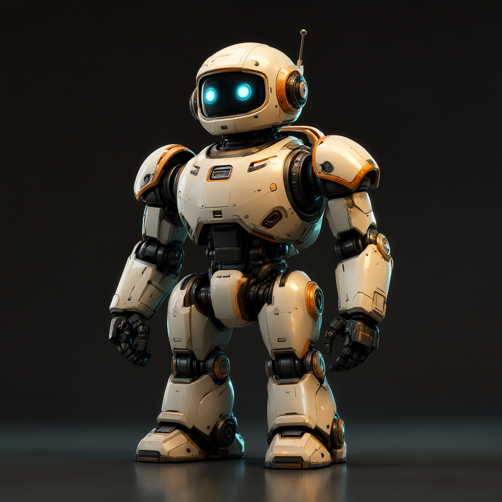

# `image` — brand-aware image generation (Qwen-Image-2.1 default · Z-Image · FLUX.2)



*Brand-neutral sample generated by this module — `chimera image --subject "a chunky sci-fi utility robot …"` (Qwen-Image-2.1, the default).*

A **tested, importable** set of image workflows for the Brand Kits pipeline.
The default backend is **Qwen-Image-2.1** (core-native in ComfyUI 0.40 — no custom node pack): in the
2026-10 model review it gave the best prompt adherence (product shots, logo layout, three distinct
subjects in one scene) at about 6 s per 1024² image. **Tongyi Z-Image** stays as the fast alternative
and **FLUX.2** as the cinematic / relight backend. Switching is one flag (`--model`) or a brand pin.

## Files

**Qwen-Image-2.1 templates (default)**
- [`workflow.qwen-image-txt2img.template.json`](workflow.qwen-image-txt2img.template.json) — Qwen-Image-2.1
  text-to-image (25 steps, CFG 1). Copy also in
  [`../../workflows/templates/brand-qwen-image-txt2img.json`](../../workflows/templates/brand-qwen-image-txt2img.json).
- [`workflow.qwen-image-logo-overlay.template.json`](workflow.qwen-image-logo-overlay.template.json) —
  txt2img + in-graph brand logo composite. Copy also in
  [`../../workflows/templates/brand-qwen-image-logo-overlay.json`](../../workflows/templates/brand-qwen-image-logo-overlay.json).
- [`workflow.qwen-image-product.template.json`](workflow.qwen-image-product.template.json) — product
  mockup as a **reference edit** (the product photo is a reference image to the text encoder). Copy also in
  [`../../workflows/templates/brand-qwen-image-product.json`](../../workflows/templates/brand-qwen-image-product.json).

**Z-Image templates**
- [`workflow.zimage-txt2img.template.json`](workflow.zimage-txt2img.template.json) — Z-Image
  text-to-image (turbo, 8 steps). Copy also in
  [`../../workflows/templates/brand-zimage-txt2img.json`](../../workflows/templates/brand-zimage-txt2img.json).
- [`workflow.zimage-logo-overlay.template.json`](workflow.zimage-logo-overlay.template.json) — Z-Image
  txt2img + in-graph brand logo composite. Copy also in
  [`../../workflows/templates/brand-zimage-logo-overlay.json`](../../workflows/templates/brand-zimage-logo-overlay.json).
- [`workflow.zimage-product.template.json`](workflow.zimage-product.template.json) — Z-Image
  img2img product mockup (base, denoise 0.62). Copy also in
  [`../../workflows/templates/brand-zimage-product.json`](../../workflows/templates/brand-zimage-product.json).

**FLUX.2 template (secondary)**
- [`workflow.template.json`](workflow.template.json) — the original FLUX.2 [dev] text-to-image
  workflow (kept for reference / FLUX.2 fallback). Copy also in
  [`../../workflows/templates/flux2-txt2img.json`](../../workflows/templates/flux2-txt2img.json).

**Supporting docs**
- [`models.md`](models.md) — all model files, HF repos, destinations, and license notes.
- [`brand-kits.md`](brand-kits.md) — internals: how Brand Kits wires the pipeline together.
- [`recipes.md`](recipes.md) — field-tested, brand-neutral recipes for creator/community assets
  (platform emotes & stickers, tiered badge sets, animated-logo stingers).

## Use it — unified CLI

```
python scripts/generate.py image \
  --brand <brand> \
  --mode txt2img \
  --subject "product shot on a minimalist white background, dramatic light" \
  [--watermark] \
  [--variant base] \
  [--seed 7] \
  --comfy-output-dir "<ComfyUI output dir>"
```

### Modes

| `--mode` | What it does | Z-Image variant |
|----------|--------------|-----------------|
| `txt2img` | Text → on-brand image | `turbo` |
| `logo` | `txt2img` + in-graph composite of the real brand logo PNG | `turbo` |
| `product` | **Qwen-Image:** a reference edit — the product photo goes to the text encoder as a reference image, so the product keeps its exact look in a new scene, rendered at the brand size. **Z-Image / FLUX.2:** img2img (restyle in-brand) at denoise 0.62 (Z-Image) or 0.65 (FLUX.2) | `base` |
| `relight` | FLUX.2 `ReferenceLatent` edit that keeps the composition ([below](#relighting-a-still-while-keeping-its-composition---mode-relight)) | — |

- `--mode logo --asset logo.png` — provide the logo filename via `--asset`.
- `--mode product --asset product.png` — provide the product image via `--asset`.

### Fidelity variants (`--variant`, Z-Image only)

| `--variant` | Model file | Steps | CFG | When to use |
|-------------|-----------|-------|-----|-------------|
| `turbo` *(default for txt2img/logo)* | `z_image_turbo_nvfp4.safetensors` | 8 | 1.0 | Fast drafts and final renders; excellent quality |
| `base` *(default for product)* | `z_image_bf16.safetensors` | 25 | 4.0 | Maximum fidelity; always used for img2img product |

The variant fully determines the model file + steps + CFG — mixing them (e.g. the
turbo model at 25 steps) degrades output. On a Z-Image model, `--variant` always wins over the
`defaults.model` setting in `brand.yaml`. Any other model ignores it (a note says so), and its
sidecar doesn't record it.

### Watermark

- `--watermark` composites the brand logo over the decoded image for `txt2img`,
  `product`, and `relight` modes.
- `logo` mode self-watermarks (the logo composite is the output itself) — passing
  `--watermark` there is a no-op.

### Upscale (`--upscale`)

- `--upscale` runs a **4× SeedVR2 7B** pass, spliced in-graph just before `SaveImage` (no host image
  libs). SeedVR2 is a one-step diffusion upscaler: lanczos-resize to the target size → tiled SeedVR2
  VAE encode → one euler step conditioned on that latent → tiled decode → `SeedVR2PostProcessing`. It
  restores real detail; the classic ESRGAN pass sharpens by inventing texture (the 2026-10 review).
- Models: `seedvr2_7b_int8_convrot.safetensors` (`diffusion_models/`) + `seedvr2_ema_vae_fp16.safetensors`
  (`vae/`). **ESRGAN option:** `--upscale-model 4x-UltraSharp.pth` (in `upscale_models/`) selects the
  `ImageUpscaleWithModel` pass; a brand can pin either via `defaults.upscale_model`.
- **Time:** 1024² → 4096² adds about 10 s on an RTX 5090 (ESRGAN: about 7 s).
- **Pipeline order:** `decode → [watermark] → upscale → save`. When `--watermark`
  is also on, the upscale takes over the watermark composite's edge into save, so
  **the logo upscales with the image** (it stays pixel-aligned, just larger).
- Works for `txt2img`, `product`, `logo`, and `relight` modes (every mode's template routes the
  final image through `brand:save`, which the upscale splices before).
- **VRAM:** 4× of 1024² is 4096². SeedVR2's VAE runs tiled (512 px tiles) and its weights are ~8 GB
  (int8), so it fits the 32 GB card next to the image model; ESRGAN auto-tiles. The large upscaled PNGs
  are generated on demand and are **not committed** (outputs are gitignored).

### Switching backends

Pass a model file name to pick the backend for one run:

```
python scripts/generate.py image \
  --brand <brand> \
  --mode txt2img \
  --subject "..." \
  --model flux2_dev_fp8mixed.safetensors     # or z_image_turbo_nvfp4.safetensors
```

Or pin `defaults.model` in `brand.yaml` (brandless runs and brands that don't pin a model use
Qwen-Image-2.1). The dispatch logic in `scripts/brandkit/workflow.py` (`family()`) routes file names
starting with `qwen_image` to the Qwen-Image templates, `z_image` to the Z-Image templates, and everything
else to the FLUX.2 templates; it reads the file name, so a model in a subfolder (`qwen/qwen_image_…`) is
sorted correctly. To re-run an old render on a new model, use `chimera replay <sidecar> --model <file>`: only
the prompt is compared with the record (the negative and settings change with the model by design), a
Z-Image `--variant` is dropped when the new model isn't Z-Image, and the result lands beside the original
as `<name>_replay`.

**License note for forks:** Qwen-Image-2.1 ships under the Qwen research license (see
[`models.md`](models.md)). If you need different terms, pin `z_image_turbo_nvfp4.safetensors`
(Apache-2.0) in your brand or pass `--model`.

## How it works

### Qwen-Image-2.1 — default backend

Qwen-Image-2.1 is core-native in ComfyUI 0.40 (int8 "convrot" weights from `Comfy-Org/Qwen-Image-2.1`).
Its text encoder is **Qwen3-VL-8B** (`CLIPLoader(type="qwen_image")`), which also reads reference images.

```
UNETLoader(qwen_image_2.1_int8_convrot) -> QwenImage21Cache ─────────────────────┐
CLIPLoader(qwen3vl_8b_int8_convrot, qwen_image) -> TextEncodeQwenImage21         │
      (prompt + negative_prompt; product: + images.image_1 = product photo, vae)  │
            ├─ out 0 positive ─┐                                                  │
            └─ out 1 negative ─┴─> KSampler(euler/simple, 25 steps, CFG 1) <──────┘
EmptyLatentImage(brand width x height) ──────────────┘
      -> VAEDecode(qwen_image_2.1_vae) -> [logo composite / watermark / upscale] -> SaveImage
```

### Z-Image — fast alternative

Z-Image is a **core-native** ComfyUI model (support added in 0.22.3) — no custom
node pack needed. It uses a **Qwen-3-4B text encoder** loaded via
`CLIPLoader(qwen_3_4b.safetensors, type="lumina2")` (not a CLIP/T5 stack), and the
**AuraFlow sampler schedule** wrapped by `ModelSamplingAuraFlow(shift=3)`.

#### `txt2img` graph

```
UNETLoader(z_image) → ModelSamplingAuraFlow(shift 3)
CLIPLoader(qwen_3_4b, type="lumina2")
VAELoader(ae.safetensors)
CLIPTextEncode(positive) → ConditioningZeroOut(negative)
EmptySD3LatentImage → KSampler → VAEDecode → SaveImage
```

The negative is produced by `ConditioningZeroOut` applied to the *positive*
conditioning — no separate negative text prompt is needed.

#### `logo-overlay` graph

The `txt2img` graph extended with an in-graph composite: after `VAEDecode`, the
brand logo PNG is loaded, alpha-masked, scaled, and composited at the
position/margin specified in `brand.yaml`. The logo is never re-drawn by the
generative model — compositing keeps it pixel-exact.

#### `product` (img2img) graph

```
UNETLoader(z_image_bf16) → ModelSamplingAuraFlow(shift 3)
CLIPLoader(qwen_3_4b, type="lumina2")
VAELoader(ae.safetensors)
LoadImage(product) → VAEEncode → KSampler(denoise=0.62) → VAEDecode → SaveImage
```

Denoise 0.62 retains the product's structure while restyling its scene and
lighting in-brand. `base` fidelity is always used here regardless of `--variant`.

**Note on Z-Image Omni / `TextEncodeZImageOmni`:** the Z-Image Omni
image-reference path was evaluated and is **not used**. It errors with the
available txt2img weights (a dedicated edit checkpoint is required). The `img2img`
VAEEncode path is the robust alternative for product mockups.

### FLUX.2 — secondary backend

Any model whose name starts with `flux2` routes to the original FLUX.2 templates.
FLUX.2 uses a **split loader** (UNET + `CLIPLoader(type="flux2")` Mistral-3 encoder
+ VAE) and a `FluxGuidance` node. See [`workflow.template.json`](workflow.template.json)
and the "gotchas" section below for details.

## Why Qwen-Image-2.1 needs this exact graph (the gotchas)

- **One encoder node carries both prompts:** `TextEncodeQwenImage21` takes `prompt` and
  `negative_prompt` and outputs positive (0) and negative (1) conditioning. There is no separate
  negative text node, so the brand negative goes on `brand:positive`'s `negative_prompt`.
- **Fixed sampler settings:** euler / simple, **25 steps, CFG 1** (the official template's validated
  values). A brand's `steps` / `guidance` are FLUX.2 settings and are not applied to Qwen-Image.
- **`QwenImage21Cache`** sits between the UNET and the sampler (a brand LoRA splices in before it).
- **Plain `EmptyLatentImage`**, not the SD3 latent.
- **Product mode is an edit, not img2img:** the product photo feeds `images.image_1` (plus the `vae`
  input), and the image renders from an empty latent at the brand size. The watermark therefore places on
  the brand canvas, not the photo's size.
- The official template's optional **prompt enhancer** (a separate Qwen3.5-9B model) is not used:
  Chimera's agent loop has its own LLM prompt rewriter (`--rewrite-prompts`).

## Why Z-Image needs this exact graph (the gotchas)

- The text encoder is **`CLIPLoader` with `type: "lumina2"`** — not `type: "clip_l"`
  or `type: "flux2"`. Using the wrong type will fail silently or produce garbage.
- The latent is **`EmptySD3LatentImage`** (16-channel), not `EmptyLatentImage`.
- The negative conditioning is **`ConditioningZeroOut`** applied to the positive
  output — not an empty text prompt.
- The sampler must be wrapped by **`ModelSamplingAuraFlow(shift=3)`** before being
  passed to `KSampler`.
- **Variant pairing is strict:** the turbo model expects 8 steps / CFG 1.0; the
  base model expects 25 steps / CFG 4.0. Do not mix.

## Why FLUX.2 needs its own graph (the gotchas)

- **Split loaders required:** `UNETLoader` + `CLIPLoader(type="flux2")` +
  `VAELoader`. `CheckpointLoaderSimple` will not work.
- Latent is **`EmptySD3LatentImage`** (16-channel).
- Guidance is a dedicated **`FluxGuidance`** node (default `3.5`); **`cfg` is `1`**
  in `KSampler` (guidance-distilled — real CFG is off).
- Sampler/scheduler: **`euler` / `simple`**, ~20 steps.

### Relighting a still while keeping its composition (`--mode relight`)

To change a still's **lighting or look while preserving its exact composition** (relight a product
shot, swap day→dusk/night), use **`--mode relight`** — FLUX.2's native **`ReferenceLatent` edit**:

```
python scripts/generate.py image --mode relight \
  --asset <source.png> \
  --subject "the same scene relit with warm golden-hour rim light, deep shadows, cinematic" \
  --comfy-output-dir "<ComfyUI output dir>"
```

- `--asset` is the source still (a brand `products/`/`references/`/`outputs/images/` file, or — when
  brandless — a direct path). `--subject` is the relight prompt.
- **Relight is a FLUX.2 capability.** The mode loads the FLUX.2 relight template and, if your brand
  default is Qwen-Image or Z-Image, transparently uses `flux2_dev_fp8mixed.safetensors`. The sidecar
  records the FLUX.2 model actually used.
- **Live-validated on ComfyUI 0.26.2** (sunset and moonlight relights both held the source's exact
  composition while transforming the lighting).

**How it works (and why not img2img):** `LoadImage(source) → VAEEncode → latent`, fed into
`ReferenceLatent(conditioning, latent)` so it rides the *positive* conditioning, then a full-denoise
sample with your relight prompt. The reference latent anchors the layout; the prompt changes only the
lighting/style. A plain img2img (partial-denoise) **drifts the composition** — it reinvents layout as
it restyles — which ReferenceLatent avoids. (A ControlNet-pack relight route was also tried and
**broke FLUX.2** on this stack; the native path needs no extra pack.)

Template: [`workflow.flux2-relight.template.json`](workflow.flux2-relight.template.json) (canonical
copy `workflows/templates/brand-flux2-relight.json`).

## Performance (RTX 5090 / cu130 / SageAttention)

| Variant | Resolution | Steps | Approx. time (warm) |
|---------|-----------|-------|---------------------|
| **Qwen-Image-2.1 (int8)** | 1024² | 25 | **~6 s** (~10 s with model load) |
| Z-Image turbo (nvfp4) | 1024² | 8 | ~4 s |
| Z-Image base (bf16) | 1024² | 25 | moderate |
| FLUX.2 fp8 | 1024² | 20 | ~22.7 s |
| FLUX.2 nvfp4 | 1024² | 20 | ~8.4 s |

First render of a session is slower (model load + one-time SageAttention / Triton
JIT). Keep the model resident for fast iteration.

## VRAM

| Model | Approx. VRAM |
|-------|-------------|
| Qwen-Image-2.1 (int8) | ~16 GB of weights (6.8 GB model + 8.7 GB Qwen3-VL-8B encoder + VAE); smaller cards rely on ComfyUI's offloading |
| Z-Image turbo (nvfp4) | ~8–12 GB |
| Z-Image base (bf16) | ~12–16 GB |
| FLUX.2 fp8 | ~16–24 GB |
| FLUX.2 nvfp4 | ~12–16 GB (cu130 only) |

See [`models.md`](models.md) for download details and quantized alternatives.
