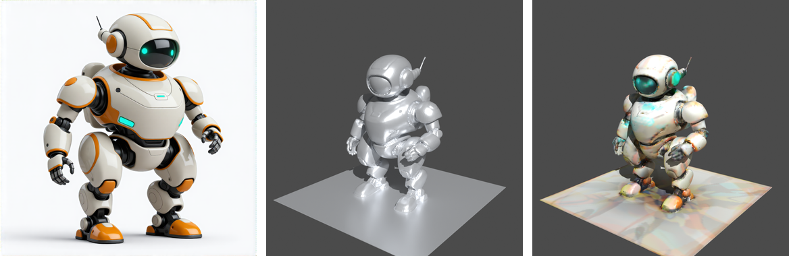

# `threed` — image-to-3D mesh generation (TRELLIS.2 default · Pixal3D · Hunyuan3D 2.1)



*The Hunyuan3D path end to end: one concept image → shape-only mesh (`chimera 3d --model hunyuan21`) → all-around auto-repaint texture (`chimera finalize-texture --auto-repaint`). Brand-neutral sample.*

Takes a single input image and produces a 3D mesh exported as a `.glb` file. Three models, all on
**ComfyUI core nodes** (no custom node pack, no gated downloads):

| `--model` | Output | Time (RTX 5090) | Pick it for |
|-----------|--------|-----------------|-------------|
| **`trellis2`** *(default)* | **textured** mesh (PBR: base color, metallic-roughness, normal, AO), background cut out | ~90–135 s | most assets; best likeness in the 2026-10 review |
| `pixal3d` | textured, like TRELLIS.2, and matched to the photo's camera (MoGe FOV) | ~100–115 s | reconstructing an object as photographed |
| `hunyuan21` | **shape only** (grey), ~1.1 M tris | ~25–35 s | fast drafts, 3D printing, or coloring it yourself with the Blender bakes |

A model file name works too, and a brand can pin one with `threed.model`.

## Files

- [`workflow.trellis2.template.json`](workflow.trellis2.template.json) — the TRELLIS.2 / Pixal3D graph,
  built from Comfy's official template. Its previews are rewired out and its nodes carry stable `brand:*`
  titles. A copy also lives in
  [`../../workflows/templates/brand-3d-trellis2.json`](../../workflows/templates/brand-3d-trellis2.json).
- [`workflow.template.json`](workflow.template.json) — ComfyUI **API-format**
  workflow for the Hunyuan3D 2.1 image→3D path. A copy also lives in
  [`../../workflows/templates/brand-3d-image.json`](../../workflows/templates/brand-3d-image.json).
- [`models.md`](models.md) — model files, HF repos, destinations, and license notes.

## Use it — CLI

```
python scripts/generate.py 3d \
  --brand <brand> \
  --from-image product.png \
  --seed 42 \
  [--model trellis2|pixal3d|hunyuan21] \
  [--octree 256] \
  [--format glb|stl|obj] \
  [--comfy-output-dir <dir>]
```

- `--from-image` is the source image (a file in `brands/<brand>/products/`,
  `references/`, or `outputs/images/`; searched in that order). The TRELLIS.2 / Pixal3D graph cuts the
  subject out of its background itself, so a product photo on a desk works; for Hunyuan3D use a clean
  cutout (it meshes the background too).
- `--octree` (**Hunyuan3D only**) sets `VAEDecodeHunyuan3D`'s `octree_resolution` (default `256`).
  Higher values produce denser geometry at the cost of VRAM and file size;
  lower values produce lighter meshes. See the `--octree` section below.
- `--format` picks the export format (default `glb`). ComfyUI only saves GLB,
  so `stl` and `obj` are converted **host-side** by `brandkit/mesh.py` (a
  dependency-free glTF→STL/OBJ writer). All three carry geometry only — use
  `glb` for viewing/sharing, `stl` for 3D printing, `obj` for CAD/Blender.
  (STL/OBJ of a dense mesh are large: the example rover is ~18 MB GLB, but
  ~53 MB STL / ~37 MB OBJ — generate them on demand rather than committing them.)
- There is **no `--subject`** — this modality is image-conditioned, not
  text-conditioned. The geometry is driven entirely by the input image.
- `--watermark` is silently ignored — there is no 2D canvas to composite onto.
- `--free-before` defaults ON for this modality, clearing resident image or
  video models before the 3D job starts.

Output routes to `brands/<brand>/outputs/3d/<brand>_image_<seed>.glb`.

## How it works — TRELLIS.2 / Pixal3D (default)

One core graph (ComfyUI ≥ 0.40) serves both models; `brand:use_trellis2` switches between them:

1. **`RemoveBackground`** (BiRefNet) and **`ImageCropToMask`**: cut the subject out and square-crop it.
2. **Conditioning:** `Trellis2Conditioning` (DINOv3 features of the cutout), or for Pixal3D
   `Pixal3DConditioning` plus **`MoGeInference` → `MoGeGeometryToFOV`**, which estimates the photo's camera
   so the mesh lines up with the photo's view.
3. **Three sampling stages:** sparse structure (`EmptyTrellis2LatentStructure` → `KSampler`, decoded to
   occupied voxels), then **shape** (`Trellis2ShapeStage`) and **upsample** (`Trellis2UpsampleStage`), then
   **texture** (`Trellis2TextureStage`), each with the official template's own steps/CFG. One `--seed`
   drives all four samplers (seed, seed+1, seed+2, seed+3).
4. **Mesh clean-up:** `VaeDecodeShapeTrellis` → `RemeshMesh` (UDF, 768) → `DecimateMesh` (~700 K faces) →
   `MeshSmoothNormals` → `UnwrapMesh` (UV atlas).
5. **PBR bake (pure PyTorch, no compiled rasterizer):** `BakeTextureFromVoxel` (base color +
   metallic + roughness, 4096 px), `BakeNormalMapFromMesh` and `BakeAmbientOcclusion` from the
   high-poly mesh, then `ApplyTextureToMesh` → **`Save3DAdvanced`** writes a GLB with the textures
   embedded.

## How it works — Hunyuan3D 2.1 (`--model hunyuan21`)

The graph uses **ComfyUI core nodes only** — all of the following ship with
ComfyUI 0.22.3 and require no additional installation:

1. **`ImageOnlyCheckpointLoader`** — loads `hunyuan_3d_v2.1.safetensors` from
   `models/checkpoints/`. This single file bundles the DiT shape model, a
   DINOv2 CLIP-Vision encoder (ungated — no Hugging Face token required), and
   the 3D VAE.
2. **`ModelSamplingAuraFlow(shift 1)`** — wraps the model for the AuraFlow
   sampler schedule (shift 1.0).
3. **`LoadImage`** — loads the input image.
4. **`CLIPVisionEncode(crop=center)`** — encodes the input image through the
   bundled DINOv2 CLIP-Vision encoder to produce the conditioning signal.
5. **`Hunyuan3Dv2Conditioning`** — converts the CLIP-Vision output into positive
   and negative conditioning tensors for the KSampler.
6. **`EmptyLatentHunyuan3Dv2`** — allocates the 3D latent buffer (4096
   resolution, batch size 1).
7. **`KSampler`** — 30 steps, CFG 5.0, euler sampler, normal scheduler.
8. **`VAEDecodeHunyuan3D(octree_resolution 256)`** — decodes the latent into a
   voxel field at the specified octree resolution.
9. **`VoxelToMesh(algorithm=surface net, threshold=0.6)`** — runs surface net
   marching to extract a triangle mesh from the voxel field.
10. **`SaveGLB`** — writes the mesh as a binary glTF v2 (`.glb`) file.

## Shape-only output (Hunyuan3D) — important caveat

**The Hunyuan3D 2.1 path produces geometry only** (the TRELLIS.2 / Pixal3D default is textured). The output GLB
contains POSITION and index data (typically ~421 K vertices / ~1.1 M triangles
at `octree_resolution 256`, valid glTF-v2). It does **not** include PBR
textures, materials, or vertex colors — the mesh will appear as an untextured
grey solid in most viewers.

This is a limitation of the current native ComfyUI path, not of Hunyuan3D in
general. In-ComfyUI PBR texturing (Hunyuan3D-Paint) would require a separate
custom node pack that is wheel-blocked on this stack (see below) — but the
self-correction loop **does** texture its winning mesh automatically via a
Blender multi-view bake (`--finalize`, described below), and downstream texturing
in Blender, Substance Painter, or similar tools works fine on the exported geometry.

### Why Hunyuan3D-Paint (in-ComfyUI PBR painting for Hunyuan meshes) is still deferred

**Textured meshes no longer need it:** the default TRELLIS.2 / Pixal3D graph bakes PBR textures with pure
PyTorch nodes (ComfyUI ≥ 0.40). This section covers only *painting a Hunyuan3D mesh inside ComfyUI*.

Automatic Hunyuan3D-Paint texturing depends on a **compiled CUDA rasterizer**
(`custom_rasterizer` + a differentiable renderer). On the **Blackwell / cu130 / PyTorch 2.10 / Python
3.12** reference box this is currently unworkable without a heavy toolchain build:

- **No matching prebuilt wheel.** Every published `custom_rasterizer` wheel
  targets **cu126 / PyTorch 2.6** (kijai's `ComfyUI-Hunyuan3DWrapper`,
  visualbruno's `ComfyUI-Hunyuan3d-2-1`) or at best **cu129 / PyTorch 2.8**. A
  PyTorch C++/CUDA extension is ABI-bound to the torch minor version it was built
  against, so a 2.6/2.8 wheel will not import under 2.10 — and a cu126 wheel
  carries no `sm_120` (Blackwell) kernels.
- **No from-source compile available out of the box.** Building the rasterizer
  for `sm_120` against the installed torch needs the standalone **CUDA Toolkit
  (`nvcc`)**, which is not installed (ComfyUI ships only PyTorch's bundled CUDA
  runtime, not a compiler). Installing the ~3 GB toolkit + compiling is a large,
  failure-prone change to a working ComfyUI and is intentionally not automated
  here.

**The self-correction loop textures its winner automatically (shipped).**
`auto_generate.py --pipeline mesh3d --finalize` runs the Blender **multi-view auto-repaint bake** on
the winning mesh (SDXL depth-ControlNet + IPAdapter → `bake_multiview`) and emits a textured GLB — the
supported in-pipeline texturing path on this stack (the in-ComfyUI Hunyuan3D-Paint below stays
wheel-blocked). For a one-off on any GLB, `generate.py finalize-texture --auto-repaint` does the same.

**How to texture an exported mesh today** (all operate on the shape-only GLB):

1. **DCC tools** — import the GLB into Blender / Substance Painter / ZBrush and
   paint or bake materials. Reliable, no GPU-extension dependency.
2. **A cu126/torch2.6 environment** — run kijai's `ComfyUI-Hunyuan3DWrapper` or
   visualbruno's `ComfyUI-Hunyuan3d-2-1` (with their prebuilt rasterizer wheels)
   in a separate, matching ComfyUI, and texture the GLB there.
3. **Revisit when wheels catch up** — once a `custom_rasterizer` wheel ships for
   cu130 / torch 2.10 / `sm_120`, an in-ComfyUI **Hunyuan3D-Paint** PBR path becomes a
   clean addition (distinct from the already-shipped Blender-bake `--texture`/`--finalize`
   above; the shape path here already produces a valid glTF-v2 mesh to paint).

## `--octree` — geometry detail vs file size (Hunyuan3D only)

`octree_resolution` controls the resolution of the voxel grid used during
VAE decode. Higher = more triangles, more detail, larger file, more peak VRAM.

| `--octree` | Approximate triangles | Approximate GLB size |
|------------|----------------------|----------------------|
| 128        | ~280 K               | ~5–8 MB              |
| 256        | ~1.1 M               | ~18 MB               |
| 384        | ~2.5 M               | ~40 MB               |
| 512        | ~4.5 M               | ~70 MB               |

Default is `256`. Use `128` for lightweight previews; `384`+ for high-detail
hero assets (check VRAM headroom before going above `256` on cards with less
than 32 GB).

## Preparing a mesh for 3D printing / casting (field-tested)

Turning a generated mesh into a physical object (3D print or cast) is easier when you treat it
as **one watertight solid**, not an assembly:

- **Prefer a single fused solid over a kit-of-parts.** When converting a logo, emblem, or
  figure into a physical object, model/mesh the *whole thing* as one solid. A multi-part "kit"
  multiplies failure points — each part must be independently manifold, correctly oriented, and
  fit-assembled — whereas a single fused solid slices and casts far more predictably. (Lesson
  from a logo → cast-object project: the one-solid version won decisively over the kit version.)
- **Clean stray geometry first.** Hunyuan3D often meshes the concept image's flat
  background/ground as stray plane geometry. Before slicing, **weld** coincident vertices,
  **separate by loose parts**, and **drop near-planar fragments** (thinnest dimension < ~2% of
  the longest). The Blender `mesh_finish` path (`generate.py render ... --finish`) does the
  weld / voxel-remesh / decimate / scale pass and exports a clean STL + GLB.
- **Watertight + real wall thickness.** Slicers need a manifold, watertight solid; surface-net
  output can have thin or open shells — thicken/voxel-remesh as needed.
- **Formats:** `--format stl` for printing; for parametric, dimensioned parts author them in
  FreeCAD instead (`generate.py cad` → STEP/STL) where wall thickness and fit are exact.

## VRAM

**TRELLIS.2 / Pixal3D:** ~8 GB of weights in total. The model is ~5 GB int8; the rest is the two VAEs,
DINOv3, BiRefNet and MoGe. A run used about **12–15 GB of the whole card** at its busiest (sampled with
`nvidia-smi` on the RTX 5090, ComfyUI's own cache included), so a 16–24 GB card is enough; ComfyUI
offloads on smaller ones. `--free-before` (default ON) clears resident image/video models first.

**Hunyuan3D 2.1:**

| Step | Approximate VRAM | Notes |
|------|-----------------|-------|
| Checkpoint load | ~7.4 GB | Single-file: DiT + DINOv2 + VAE |
| KSampler (30 steps) | ~8–10 GB peak | Scales with batch and latent res |
| VAEDecodeHunyuan3D | ~4–6 GB peak | Scales with `octree_resolution` |
| VoxelToMesh | CPU-side | Offloaded; not VRAM-bound |

Total peak is within the 32 GB reference card at `octree_resolution 256`.
`--free-before` (default ON) clears resident image/video models beforehand.
If you have a card with less VRAM, lower `--octree` to reduce decode pressure.

## Why TRELLIS.2 is the default now (and when Hunyuan3D still wins)

Until 2026-10 TRELLIS.2 was blocked here. Its only ComfyUI route was the `visualbruno/ComfyUI-Trellis2`
node pack, whose prebuilt CUDA wheels didn't match Python 3.12 / PyTorch 2.10 / cu130, and its DINOv3
encoder sat behind a gated Hugging Face download. **ComfyUI 0.40 made it core.** The model runs on native
nodes, the bake is pure PyTorch, and the Comfy-Org packaging needs no login.

In the 2026-10 review (three photos, same seeds), TRELLIS.2 and Pixal3D both beat Hunyuan3D 2.1:
- they come out textured;
- they cut the subject out of a cluttered photo, where Hunyuan3D rebuilt the desk and monitor with it;
- TRELLIS.2 was the most faithful on two of three, and Pixal3D was cleaner on the third.

**Hunyuan3D still wins on speed** (about 4×), and its dense shape-only mesh is a good start for **3D
printing**: `--format stl` plus the `mesh_finish` path below. The Blender color bakes (`--texture`,
`--finalize`, `finalize-texture`) also target it.

## Local-only and offline

Both graphs are ComfyUI core-native — no node pack, no external network calls
during inference, no auto-downloads on first run (the Hunyuan3D checkpoint bundles DiT + DINOv2 + VAE;
the TRELLIS.2 / Pixal3D files are listed in [`models.md`](models.md)). Fully air-gappable after the
initial model download.

## Performance (RTX 5090 / cu130 / SageAttention)

| Model | Per mesh (warm) | Output |
|-------|-----------------|--------|
| TRELLIS.2 | ~90–135 s | ~700 K-face textured GLB (3 embedded textures, 4096 px) |
| Pixal3D | ~100–115 s | same, matched to the photo's camera |
| Hunyuan3D 2.1 | ~25–35 s | ~1.1 M-tri shape-only GLB at `octree_resolution 256` |

Model load is the dominant cost in the first session; subsequent runs in the same session skip it.
